# GeekMagic Display for Home Assistant

[](https://github.com/hacs/integration)

<p align="center">
  
</p>

A Home Assistant custom integration for GeekMagic displays (SmallTV Pro, Ultra, and similar ESP8266/ESP32-based devices).

> **How it works:** Home Assistant renders your dashboards itself, with the [Blitz](https://github.com/DioxusLabs/blitz) HTML/CSS engine (no browser), and pushes the images to the device over HTTP. No flashing needed: the device keeps its firmware. Known stock firmware profiles are supported, as is the SD_PRO-style firmware some Ultra units ship with.

## Contents

- [Dashboard samples](#dashboard-samples)
- [Features](#features)
- [Installation](#installation)
- [Widgets](#widgets)
- [Layouts](#layouts)
- [Themes](#themes)
- [Configuration](#configuration)
- [Entities, services & automations](#entities-services--automations)
- [Device compatibility](#device-compatibility)
- [Development](#development)
- [Background & Credits](#background--credits)

More detail lives in [`docs/`](https://github.com/adrienbrault/geekmagic-hacs/blob/main/docs/README.md): [every widget at every size](https://github.com/adrienbrault/geekmagic-hacs/blob/main/docs/widgets.md), the [HTML widget](https://github.com/adrienbrault/geekmagic-hacs/blob/main/docs/html-widget.md), [layouts](https://github.com/adrienbrault/geekmagic-hacs/blob/main/docs/layouts.md), [entities & the notify service](https://github.com/adrienbrault/geekmagic-hacs/blob/main/docs/automation.md), [device compatibility](https://github.com/adrienbrault/geekmagic-hacs/blob/main/docs/devices/README.md) and [development](https://github.com/adrienbrault/geekmagic-hacs/blob/main/docs/development.md).

## Dashboard samples

<p align="center">
  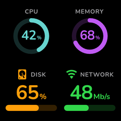
  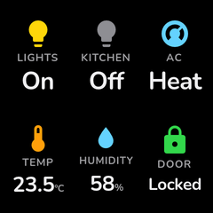
  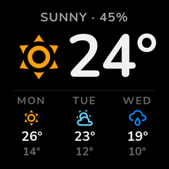
  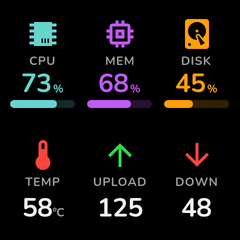
</p>

<p align="center">
  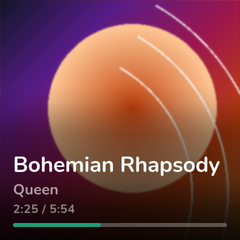
  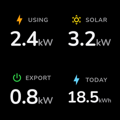
  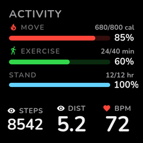
  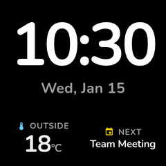
</p>

<p align="center">
  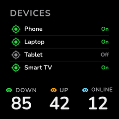
  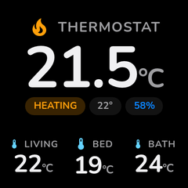
  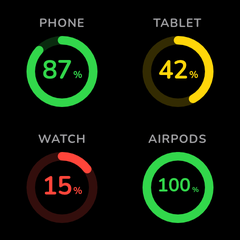
  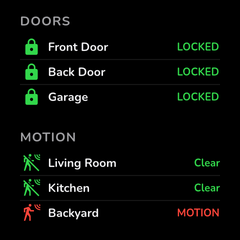
</p>

## Features

- **17 widget types**: entity, date/time, gauge (bar/ring/arc), progress, multi progress, clock, weather, status, status list, climate, chart, candlestick, media player, camera, image, text, and a free-form HTML widget
- **19 layouts**: fullscreen, grids, splits, columns/rows, hero variants and sidebars
- **17 themes**: complete design systems (type, shapes, chrome, effects), not just palettes; the default is watchOS-inspired
- **Visual configuration**: a GeekMagic sidebar panel with a live preview
- **Global views**: create views once, assign them to any number of devices, and cycle through them automatically
- **HTML widget**: design your own cells with HTML/CSS and Jinja, optionally animated
- **Live labels**: every widget's label accepts a Home Assistant template
- **Notifications**: a `geekmagic.notify` action shows temporary alerts with text, icons, camera images, or any picture by URL/path
- **Automation-friendly**: brightness, sleep/wake, view selection and cycling are all entities
- **Configurable refresh**: every 1-300 seconds

## Installation

### HACS (recommended)

1. Open HACS in Home Assistant
2. Click "Custom repositories"
3. Add this repository URL (type: Integration)
4. Install "GeekMagic Display"
5. Restart Home Assistant

### Manual

1. Copy `custom_components/geekmagic` to your Home Assistant's `custom_components` folder
2. Restart Home Assistant

## Widgets

Every widget adapts to the cell it lands in. Here is each one fullscreen, in a 2×2 grid and in a 3×3 grid; click a name for every size and its options.

| Widget | Fullscreen | 2×2 grid | 3×3 grid |
|--------|:-:|:-:|:-:|
| **[Entity](https://github.com/adrienbrault/geekmagic-hacs/blob/main/docs/widgets.md#entity)** | 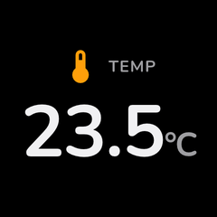 | 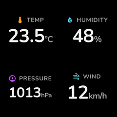 | 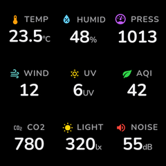 |
| **[Date / Time](https://github.com/adrienbrault/geekmagic-hacs/blob/main/docs/widgets.md#date--time)** | 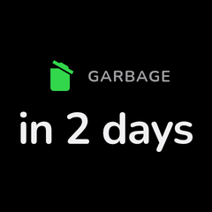 | 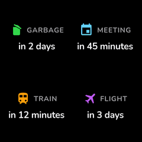 | 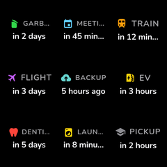 |
| **[Gauge (Bar)](https://github.com/adrienbrault/geekmagic-hacs/blob/main/docs/widgets.md#gauge)** | 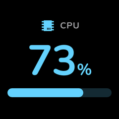 | 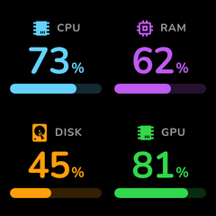 | 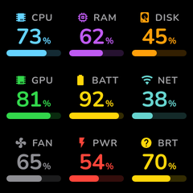 |
| **[Gauge (Ring)](https://github.com/adrienbrault/geekmagic-hacs/blob/main/docs/widgets.md#gauge)** | 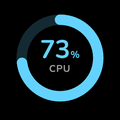 | 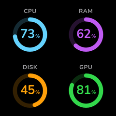 | 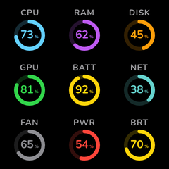 |
| **[Gauge (Arc)](https://github.com/adrienbrault/geekmagic-hacs/blob/main/docs/widgets.md#gauge)** | 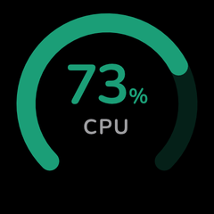 | 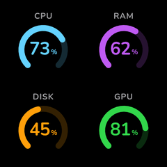 | 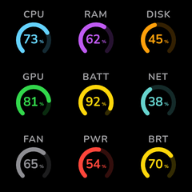 |
| **[Progress](https://github.com/adrienbrault/geekmagic-hacs/blob/main/docs/widgets.md#progress)** | 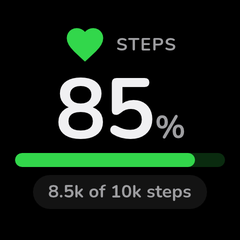 | 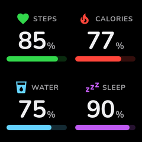 | 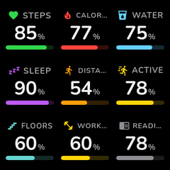 |
| **[Multi Progress](https://github.com/adrienbrault/geekmagic-hacs/blob/main/docs/widgets.md#multi-progress)** | 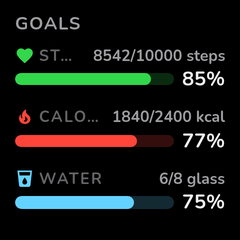 | 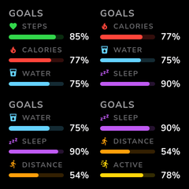 | 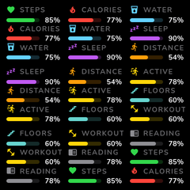 |
| **[Clock](https://github.com/adrienbrault/geekmagic-hacs/blob/main/docs/widgets.md#clock)** | 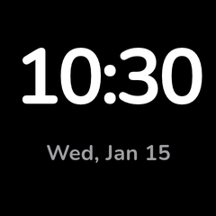 | 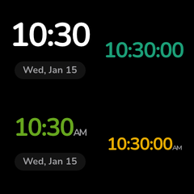 | 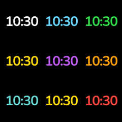 |
| **[Weather](https://github.com/adrienbrault/geekmagic-hacs/blob/main/docs/widgets.md#weather)** | 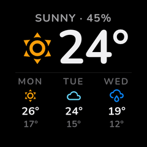 | 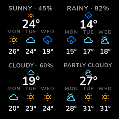 | 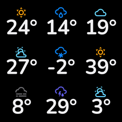 |
| **[Status](https://github.com/adrienbrault/geekmagic-hacs/blob/main/docs/widgets.md#status)** | 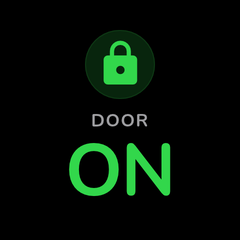 | 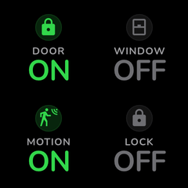 | 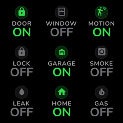 |
| **[Status List](https://github.com/adrienbrault/geekmagic-hacs/blob/main/docs/widgets.md#status-list)** | 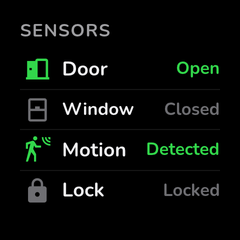 | 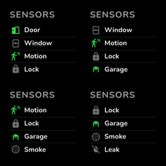 | 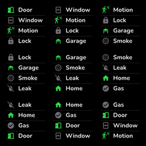 |
| **[Climate](https://github.com/adrienbrault/geekmagic-hacs/blob/main/docs/widgets.md#climate)** | 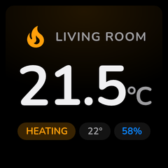 | 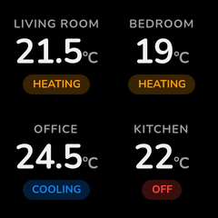 | 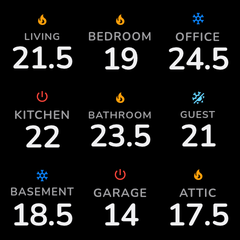 |
| **[Chart](https://github.com/adrienbrault/geekmagic-hacs/blob/main/docs/widgets.md#chart)** | 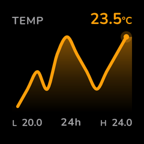 | 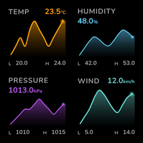 |  |
| **[Candlestick](https://github.com/adrienbrault/geekmagic-hacs/blob/main/docs/widgets.md#candlestick-chart)** |  |  |  |
| **[Media Player](https://github.com/adrienbrault/geekmagic-hacs/blob/main/docs/widgets.md#media-player)** |  |  |  |
| **[Camera](https://github.com/adrienbrault/geekmagic-hacs/blob/main/docs/widgets.md#camera)** |  |  |  |
| **[Image](https://github.com/adrienbrault/geekmagic-hacs/blob/main/docs/widgets.md#image)** |  |  |  |
| **[Text](https://github.com/adrienbrault/geekmagic-hacs/blob/main/docs/widgets.md#text)** |  |  |  |
| **[HTML](https://github.com/adrienbrault/geekmagic-hacs/blob/main/docs/html-widget.md)** |  |  |  |

The HTML widget takes any HTML/CSS and Jinja you write, animated with CSS if you like. [20 example templates](https://github.com/adrienbrault/geekmagic-hacs/blob/main/docs/html-widget.md#examples), each shown with its source:

<p align="center">   </p>

Every widget's label also accepts a Home Assistant template ([details](https://github.com/adrienbrault/geekmagic-hacs/blob/main/docs/widgets.md#templates-in-labels)).

### State icons

Entity widgets pick icons and wording from the entity's state: binary sensors by `device_class` (door open/closed, motion detected/clear, lock locked/unlocked…, from Home Assistant's own icon definitions), and lights, switches and fans by on/off ([details](https://github.com/adrienbrault/geekmagic-hacs/blob/main/docs/widgets.md#binary-sensor-states-and-icons)).

<p align="center">
  
  
  
</p>

## Layouts

19 layouts split the screen into slots. A few of them:

<p align="center">
  
  
  
  
  
  
  
  
</p>

See [all layouts](https://github.com/adrienbrault/geekmagic-hacs/blob/main/docs/layouts.md) with their slot counts.

## Themes

Choose from **17 built-in themes** that go beyond colours: each applies a complete design system with its own typography (rounded Nunito on most themes), spacing, shapes, tinted gauge tracks, and visual effects.

The default `watchOS` theme is inspired by Apple's watchOS Human Interface Guidelines: true-black background, Apple system colors, opacity-based text hierarchy, tinted Activity-ring style gauges, and no card chrome, so widgets float on the background for maximum information density. `StandBy` is the same system on translucent cards, like iOS StandBy widgets; `Night` is a red-on-black bedside mode that overrides every widget colour.

| watchOS | StandBy | Night | Classic |
|:-:|:-:|:-:|:-:|
| <br>**Default**, Apple watchOS HIG-inspired | <br>Translucent cards, like iOS StandBy | <br>Red-on-black bedside mode | <br>Subtle card chrome, system colors |
| **Minimal** | **Neon** | **Retro** | **Soft** |
| <br>Sharp, monochrome | <br>Cyberpunk with glow | <br>Terminal scanlines | <br>Cozy, very rounded |
| **Ocean** | **Sunset** | **Forest** | **Light** |
| <br>Deep blue, nautical | <br>Warm coral/orange | <br>Natural earth tones | <br>Clean white background |
| **Candy** | **Blueprint** | **Ink** | **Aurora** |
| <br>Playful pastels | <br>Engineering drawing on drafting-grid paper | <br>Warm newsprint with one pot of red ink | <br>Luminous mesh-gradient poster, frosted glass |
| **Brutal** | | | |
| <br>Neo-brutalism: hard borders, harder shadows | | | |

### StandBy and Night

The dashboards above in the **StandBy** theme (widgets on translucent cards) and the **Night** theme (a single red ramp for the bedside, overriding every widget colour):

| StandBy | | | |
|:-:|:-:|:-:|:-:|
|  |  |  |  |
| **Night** | | | |
|  |  |  |  |

## Configuration

### Adding a device

1. Go to **Settings** → **Devices & Services**
2. Click **Add Integration**
3. Search for "GeekMagic"
4. Enter your device's IP address

### Changing a device's address

If DHCP moves your device to a new IP, use **Reconfigure** on the integration entry (the three-dot menu next to the device) and enter the new address. The entry keeps its views, options and entity IDs, so automations referencing the device keep working.

### Using the GeekMagic panel

After installation, a **GeekMagic** item appears in your sidebar.

#### Views tab

Create and manage display views:

- **Create views** with the "+ Add View" button
- **Edit views** by clicking on them
- **Delete views** via the menu on each card

#### View editor

The editor provides a live preview and widget configuration:

<p align="center">
  
</p>

- **Preview**: see the real rendering as you configure
- **Layout**: pick one of the 19 layouts
- **Theme**: pick one of the 17 themes
- **Widgets**: each slot shows a position grid; click cells to swap widget positions
- **Entity picker**: Home Assistant's native entity selector with filtering

#### Devices tab

Assign views to your GeekMagic devices:

- Check which views each device should display
- Assigned views form the device's rotation. Cycling is off by default: turn on the device's **View Cycling** switch (starts at 30 s) or set **View Cycle Interval** (1-300 s) to rotate automatically, or switch views by hand with the **Display** select and the next/previous buttons
- Picking one of the device's built-in modes (Clock, Weather...) while View Cycling is on shows it for one cycle interval, then the rotation resumes with the next view. Turn View Cycling off to stay on a built-in mode
- Drag to reorder the rotation sequence

#### Device info page

Each device exposes entities for brightness, refresh interval, the displayed view, and status (see [Entities, services & automations](#entities-services--automations)):

<p align="center">
  
</p>

## Entities, services & automations

Each device gets entities to control it from automations: a **Display** select (which view or built-in screen is shown), **Brightness**, an **Active** switch to sleep/wake the screen, **View Cycling** with its interval, **Animations**, refresh interval, image quality, rotation, and buttons to refresh or step through views. A `geekmagic.notify` action shows temporary alerts, with a camera snapshot or any picture by URL/path:

```yaml
action: geekmagic.notify
data:
  device_id: "abc123"
  message: "Someone at the door"
  image: camera.front_door
  duration: 30
```

See [Entities, services & automations](https://github.com/adrienbrault/geekmagic-hacs/blob/main/docs/automation.md) for the full entity list, how the integration limits flash writes, every notify option, and a presence-based sleep/wake automation.

## Device compatibility

| Device / firmware | Support |
| --- | --- |
| SmallTV Ultra, stock firmware | Full |
| SmallTV-PRO, stock firmware | Full, with a managed picture album (select the Picture app on the device once after setup) |
| Ultra with SD_PRO community-style firmware | Through the Photo slideshow |
| Smart Weather Clock, legacy web-form firmware | Through Photo mode, slot 1 |

Other GeekMagic devices may work if they expose one of those APIs. See [Device compatibility](https://github.com/adrienbrault/geekmagic-hacs/blob/main/docs/devices/README.md) for how each profile is detected, per-device reports, open-source firmware, and how to capture a report for a device that doesn't work yet.

## Development

```bash
uv sync                    # install dependencies
uv run pytest              # run tests
scripts/dev-ha             # throwaway Home Assistant with a fake device and demo views (Docker)
```

See [Development](https://github.com/adrienbrault/geekmagic-hacs/blob/main/docs/development.md) for the local Home Assistant, regenerating samples and screenshots, and testing against a real device.

## Background & Credits

I have a **GeekMagic Ultra** with ESP8266, which has [limited possibilities for flashing with ESPHome](https://community.home-assistant.io/t/installing-esphome-on-geekmagic-smart-weather-clock-smalltv-pro/618029). Instead of fighting the hardware, this integration takes a different approach: render everything server-side and push images to the device.

Special thanks to:
- The [Home Assistant Community thread](https://community.home-assistant.io/t/installing-esphome-on-geekmagic-smart-weather-clock-smalltv-pro/618029) for documenting GeekMagic device capabilities
- **[Aydar (@aydarik)](https://community.home-assistant.io/t/installing-esphome-on-geekmagic-smart-weather-clock-smalltv-pro/618029/214)** for sharing the [bash script](https://gist.github.com/aydarik/e81edaf63041a85fb0325a1c8c2e4bac) that demonstrated how to push images to these devices - the core inspiration for this integration

## License

MIT
