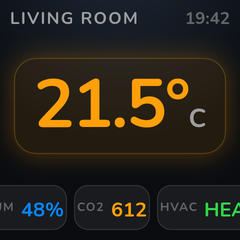

# HTML widget

Design your own cells with HTML/CSS + Jinja. A 240×240 cell renders in ~20-40ms.

 

**Contents:** [Rendering engine](#rendering-engine) · [Templates](#templates) · [Fluid templates](#fluid-templates) · [Animated widgets](#animated-widgets-opt-in) · [Limitations](#limitations)

## Rendering engine

All rendering, built-in widgets included, is powered by the [Blitz](https://github.com/DioxusLabs/blitz) HTML/CSS engine via [blitz-py](https://github.com/adrienbrault/blitz-py) (Stylo + Taffy + Parley + Vello, no browser). Every widget is an HTML fragment rasterized per cell, so real CSS drives the design: flexbox, gradients, glows, border-radius, media queries, SVG charts, embedded fonts. Themes are full stylesheets (fonts, chrome, backdrops, overlay effects like CRT scanlines), not just palettes.

`blitz-py` ships prebuilt wheels on PyPI (Linux glibc/musl x86_64 + aarch64, macOS, Windows) and installs automatically with the integration.

Modern CSS works: gradients (linear/radial/conic), `border-radius`, `box-shadow` glows, translucent `rgba()` fills and borders, flexbox, CSS grid, media queries, and viewport units.

## Templates

The **HTML Template** option is a Jinja template with access to entity data:

```html
<style>
.screen { height: 100%; display: flex; flex-direction: column;
          align-items: center; justify-content: space-evenly; }
.hero { font-size: 64px; font-weight: 700; color: var(--warning); }
.label { color: var(--text-secondary); }
</style>
<div class="screen">
  <div class="label">{{ name | upper }}</div>
  <div class="hero">{{ state }}{{ unit }}</div>
  <div class="label">HVAC {{ states('climate.living_room') | upper }}</div>
</div>
```

- `state`, `name`, `unit`, `attributes`: the widget's configured entity
- `states('sensor.x')`, `state_attr('sensor.x', 'attr')`, `is_state('sensor.x', 'on')`: any referenced entity is tracked and pre-fetched automatically
- `now`: timezone-aware current datetime
- Theme colors as CSS variables: `var(--text-primary)`, `var(--text-secondary)`, `var(--text-tertiary)`, `var(--primary)`, `var(--success)`, `var(--warning)`, `var(--error)`, `var(--info)`, `var(--muted)`, `var(--bg)`

## Fluid templates

Each cell is its own CSS viewport, so one template adapts to every cell size: `vmin`/`vw` scale the type with the cell, and media queries shed detail when space runs out. A built-in fluid kit is injected into every document:

| Class | Purpose |
|-------|---------|
| `.cell` | Flex-column scaffold filling the cell (`space-evenly`); add `.row` for horizontal |
| `.t-hero` | Primary value, scales with cell size, capped by width |
| `.t-value` | Secondary emphasized value |
| `.t-unit` | Unit suffix, secondary color |
| `.t-label` | Caps caption, tertiary color |
| `.hide-short` | Hidden when the cell is under 100px tall |
| `.hide-narrow` | Hidden when the cell is under 100px wide |
| `.hide-small` | Hidden when either dimension is under 130px |

The same template at fullscreen, 2×2, and 3×3. The hero scales, and captions and detail bands drop out automatically:

  

```html
<div class="cell">
  <div class="t-label hide-short">{{ name | upper }}</div>
  <div class="t-hero">{{ state }}&deg;</div>
  <div class="t-unit hide-small">feels 20&deg;</div>
</div>
```

These samples are generated by `scripts/generate_html_samples.py` (run via `scripts/update_samples.py`).

## Animated widgets (opt-in)

Turn on the device's **Animations** switch entity and any HTML widget with its **Animate** option enabled renders its CSS animations (`@keyframes`, transitions) to a looping animated GIF which the display plays natively. Views without animated widgets keep the smaller/faster JPEG path, and static cells in an animated view are rendered once and shared across frames. The **Animation Loop** option sets the loop length (0.8–4s; the view uses the longest loop among its widgets, at 10fps up to 2s and 7fps beyond).

**Favor ambient motion over movement**: glows that breathe, gradients that drift, colors that shift. Opacity, `background-color`, text `color`, `box-shadow`, and `background-position` all interpolate:

```html
<!-- Breathing glow (presence lamp) -->
<style>
@keyframes breathe { 0%,100% { box-shadow: 0 0 10px 1px rgba(48,209,88,0.18); }
                     50% { box-shadow: 0 0 30px 7px rgba(48,209,88,0.45); } }
.lamp { width: 34vmin; height: 34vmin; border-radius: 50%;
        animation: breathe 3.2s ease-in-out infinite; }
</style>

<!-- Aurora drift behind a value -->
<style>
@keyframes drift { 0% { background-position: 0% 0%; } 100% { background-position: -300% 0%; } }
.sky { background: linear-gradient(90deg, rgba(10,132,255,0.24) 0%,
         rgba(191,90,242,0.20) 33%, rgba(90,200,245,0.16) 66%,
         rgba(10,132,255,0.24) 100%);
       background-size: 300% 100%; animation: drift 3.2s linear infinite; }
</style>

<!-- Color-breathing value -->
<style>
@keyframes warm { 0%,100% { color: #ff9f0a; } 50% { color: #ff453a; } }
.v { animation: warm 3.2s ease-in-out infinite; }
</style>
```

Seamless-loop rules: animation durations should equal (or evenly divide) the loop length, and drifting gradients must tile. Use a 90° gradient whose first and last color stops match (diagonal gradients show a seam when the tile repeats).

Animations are off by default: a GIF costs upload size (~100KB vs ~30KB JPEG) and device decode time.

## Limitations

No JavaScript, no network fetches (use `data:` URIs for images), no `background-clip: text`, no `text-shadow`, no `filter`. `text-overflow: ellipsis` clips without drawing the "…", so truncate long strings in the template (e.g. `{{ name | truncate(12) }}`).
