# HTML widget

Design your own cells with HTML/CSS + Jinja. A 240×240 cell renders in ~20-40ms.

| [Radar sweep](#radar-sweep) | [Now playing](#now-playing) | [Thunderstorm](#thunderstorm) | [Doorbell](#doorbell) |
|:-:|:-:|:-:|:-:|
| 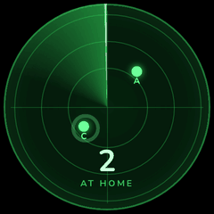 | 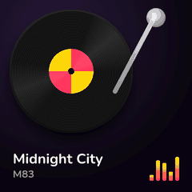 | 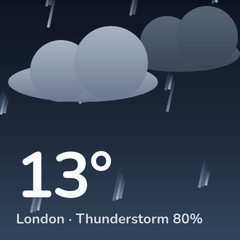 | 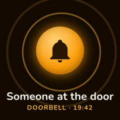 |
| [Washing machine](#washing-machine) | [Wind turbine](#wind-turbine) | [Lava lamp](#lava-lamp) | [Watch face](#watch-face) |
| 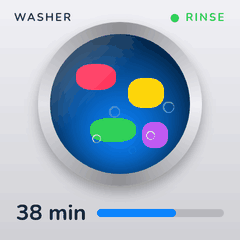 | 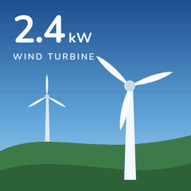 | 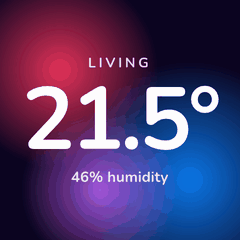 | 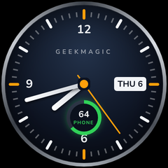 |
| [Thermostat dial](#thermostat-dial) | [Glass weather card](#glass-weather-card) | [Energy flow](#energy-flow) | [Activity rings](#activity-rings) |
| 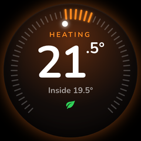 | 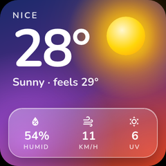 | 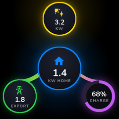 | 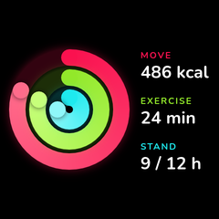 |
| [Electricity prices](#electricity-prices) | [Sun arc](#sun-arc) | [EV charging ring](#ev-charging-ring) | [Power dial (SVG)](#power-dial-svg) |
| 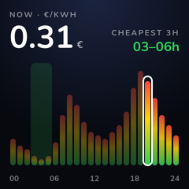 | 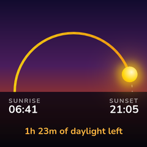 | 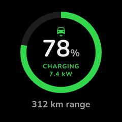 | 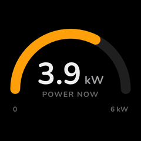 |
| [Departure board](#departure-board) | [Room temperatures](#room-temperatures) | [Who's home](#whos-home) | [Air quality](#air-quality) |
| 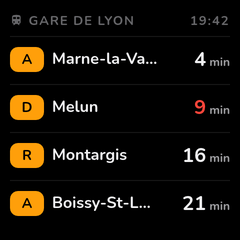 | 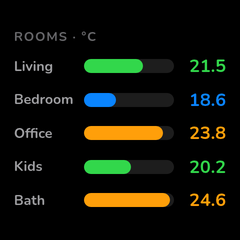 | 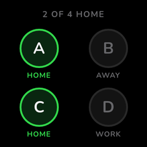 | 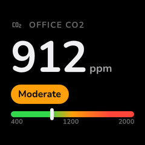 |

**Contents:** [Rendering engine](#rendering-engine) · [Templates](#templates) · [Examples](#examples) · [Fluid templates](#fluid-templates) · [Animated widgets](#animated-widgets-opt-in) · [Limitations](#limitations)

## Rendering engine

All rendering, built-in widgets included, is powered by the [Blitz](https://github.com/DioxusLabs/blitz) HTML/CSS engine via [blitz-py](https://github.com/adrienbrault/blitz-py) (Stylo + Taffy + Parley + Vello, no browser). Every widget is an HTML fragment rasterized per cell, so real CSS drives the design: flexbox, gradients, glows, border-radius, media queries, SVG charts, embedded fonts. Themes are full stylesheets (fonts, chrome, backdrops, overlay effects like CRT scanlines), not just palettes.

`blitz-py` ships prebuilt wheels on PyPI (Linux glibc/musl x86_64 + aarch64, macOS, Windows) and installs automatically with the integration.

Modern CSS works: gradients (linear/radial/conic, including `repeating-*`), `transform` (rotate/translate/scale with `transform-origin`), `clip-path`, `border-radius`, `box-shadow` glows (inset too), translucent `rgba()` fills and borders, flexbox, CSS grid, absolute positioning, media queries, viewport units, and inline SVG with gradient fills and strokes.

## Templates

The **HTML Template** option is a Jinja template with access to entity data:

```html
<style>
.screen { height: 100%; display: flex; flex-direction: column;
          align-items: center; justify-content: space-evenly; }
.hero { font-size: 64px; font-weight: 700; color: var(--warning); }
.label { color: var(--text-secondary); }
</style>
<div class="screen">
  <div class="label">{{ name | upper }}</div>
  <div class="hero">{{ state }}{{ unit }}</div>
  <div class="label">HVAC {{ states('climate.living_room') | upper }}</div>
</div>
```

- `state`, `name`, `unit`, `attributes`: the widget's configured entity
- `states('sensor.x')`, `state_attr('sensor.x', 'attr')`, `is_state('sensor.x', 'on')`: any referenced entity is tracked and pre-fetched automatically
- `now`: timezone-aware current datetime
- Theme colors as CSS variables: `var(--text-primary)`, `var(--text-secondary)`, `var(--text-tertiary)`, `var(--primary)`, `var(--success)`, `var(--warning)`, `var(--error)`, `var(--info)`, `var(--muted)`, `var(--bg)`, plus `var(--chip-bg)`, `var(--hairline)` and `var(--track)` (neutral fills and strokes that work on light themes too), `var(--accent-0)`…`var(--accent-N)` and `var(--radius)`
- Standard Jinja: ``, ``, ``, and filters like `float`, `int`, `round`, `abs`, `min`, `max`, `selectattr`, `truncate`. Home Assistant's own template extensions (`| as_timestamp`, `relative_time`, …) aren't available here.

### Template tips

- **Reference entities literally.** Only entity IDs written as quoted strings in `states('…')`, `state_attr('…', …)` or `is_state('…', …)` are fetched for the widget. `states(eid)` with a variable reads `unknown`, so to loop over entities, build the list from the calls themselves: ``.
- **Icons:** the Material Design Icons font is embedded. Use the kit's `icon` class with the icon's codepoint (shown on [pictogrammers.com](https://pictogrammers.com/library/mdi/) as e.g. `F050F`): `<span class="icon">&#xF050F;</span>` is `mdi:thermometer`. Size and tint it with `font-size` and `color`.
- **Numbers:** states are strings. Convert with `| float(0)` before doing math or comparisons; the `0` is the fallback for `unavailable`.
- **Truncating:** `truncate` has a 5-character leeway by default, so pass all four arguments to cut exactly: `{{ name | truncate(12, true, '…', 0) }}`.
- **SVG colours:** `var(--x)` doesn't resolve inside SVG `fill`/`stroke` attributes. Compute a concrete colour in Jinja (see the [power dial](#power-dial-svg)).

## Examples

Every example below is a real template, rendered by the integration's own pipeline from the mock entities in `scripts/generate_html_samples.py`. Paste one into a widget's **HTML Template** and swap in your own entity IDs. The animated ones are in [Animated widgets](#animated-widgets-opt-in).

### Showcase

How far one cell can go: transforms placing things on circles, layered and conic gradients, glass, glows, and SVG with gradient strokes. These use their own colours rather than the theme's, like a watch face would.

#### Watch face

An analog face from 60 rotated ticks, a brushed-metal conic-gradient bezel, a date window and a phone-battery subdial. Hands are `rotate()`d from `now`; numerals use `rotate() translateY() rotate(-)` to sit upright on the circle.


```html
{% set h = now.hour % 12 %}

<style>
.bezel { position: absolute; top: 2px; left: 2px; right: 2px; bottom: 2px; border-radius: 50%;
         background: conic-gradient(#3a3f47, #d9dde3, #4a4f57, #aab0b8, #3a3f47, #c8ccd2, #3a3f47);
         box-shadow: 0 6px 18px rgba(0,0,0,0.8); }
.dial { position: absolute; top: 7px; left: 7px; right: 7px; bottom: 7px; border-radius: 50%;
        background: radial-gradient(circle at 50% 30%, #23324a 0%, #0c1220 62%, #05070c 100%);
        box-shadow: inset 0 0 0 1px rgba(255,255,255,0.08), inset 0 10px 30px rgba(0,0,0,0.7); }
.c { position: absolute; left: 50%; top: 50%; }
.tick { width: 2px; height: 7px; margin: -3.5px 0 0 -1px; background: rgba(255,255,255,0.35); }
.tick.hr { width: 4px; height: 15px; margin: -7.5px 0 0 -2px; background: #f2f4f7; border-radius: 2px; }
.tick.q { background: #ff9f0a; }
.num { width: 30px; margin: -10px 0 0 -15px; text-align: center; font-size: 17px;
       font-weight: 800; color: #f2f4f7; line-height: 20px; }
.brand { width: 120px; margin-left: -60px; top: 27%; text-align: center; font-size: 9px;
         font-weight: 800; letter-spacing: 0.35em; color: rgba(255,255,255,0.55); }
.date { left: 69%; top: 50%; margin-top: -10px; padding: 2px 5px; border-radius: 4px;
        background: #f2f4f7; color: #0c1220; font-size: 12px; font-weight: 800; line-height: 16px; }
.sub { width: 50px; height: 50px; margin-left: -25px; top: 60%; border-radius: 50%;
       background: conic-gradient(#30d158 0deg {{ batt * 3.6 }}deg, rgba(255,255,255,0.10) {{ batt * 3.6 }}deg);
       box-shadow: 0 0 12px rgba(48,209,88,0.35); }
.sub-in { position: absolute; top: 5px; left: 5px; right: 5px; bottom: 5px; border-radius: 50%;
          background: #0b111d; display: flex; flex-direction: column; align-items: center;
          justify-content: center; line-height: 1; }
.sub-in b { font-size: 13px; font-weight: 800; color: #f2f4f7; }
.sub-in span { font-size: 7px; font-weight: 800; letter-spacing: 0.12em; color: #30d158; margin-top: 2px; }
.hand { transform-origin: 50% 100%; border-radius: 4px; }
.hour { width: 8px; height: 58px; margin: -58px 0 0 -4px; background: linear-gradient(#ffffff, #c9ced6);
        box-shadow: 0 2px 6px rgba(0,0,0,0.6); }
.min { width: 6px; height: 88px; margin: -88px 0 0 -3px; background: linear-gradient(#ffffff, #c9ced6);
       box-shadow: 0 2px 6px rgba(0,0,0,0.6); }
.sec { width: 2px; height: 104px; margin: -88px 0 0 -1px; background: #ff9f0a; transform-origin: 50% 84.6%; }
.pin { width: 12px; height: 12px; margin: -6px 0 0 -6px; border-radius: 50%; background: #ff9f0a;
       box-shadow: 0 0 0 3px #0c1220; }
</style>
<div class="bezel"></div>
<div class="dial">
  
  <div class="c tick {{ 'hr' if i % 5 == 0 }} {{ 'q' if i % 15 == 0 }}"
       style="transform: rotate({{ i * 6 }}deg) translateY(-100px)"></div>
  
  
  <div class="c num" style="transform: rotate({{ n * 30 }}deg) translateY(-78px) rotate({{ -n * 30 }}deg)">{{ n }}</div>
  
  <div class="c brand">GEEKMAGIC</div>
  <div class="c date">{{ now.strftime('%a').upper() }} {{ now.day }}</div>
  <div class="c sub"><div class="sub-in"><b>{{ batt | int }}</b><span>PHONE</span></div></div>
  <div class="c hand hour" style="transform: rotate({{ (h + m / 60) * 30 }}deg)"></div>
  <div class="c hand min" style="transform: rotate({{ m * 6 + s / 10 }}deg)"></div>
  <div class="c hand sec" style="transform: rotate({{ s * 6 }}deg)"></div>
  <div class="c pin"></div>
</div>
```

#### Thermostat dial

A climate entity as a glowing dial: 55 ticks across a 270° arc, the ones between the current and target temperature lit, with a dot for the room's reading. The disc's glow switches between heating and idle.


```html



{# 10-30 °C spread over a 270° arc: angle = -135 + (t - 10) * 13.5 #}
<style>
.disc { position: absolute; top: 6px; left: 6px; right: 6px; bottom: 6px; border-radius: 50%;
        background: radial-gradient(circle at 50% 28%, {{ '#5a2a10' if heating else '#1d2733' }} 0%,
                    #120c0a 58%, #050404 100%);
        box-shadow: 0 0 34px {{ 'rgba(255,120,30,0.45)' if heating else 'rgba(10,132,255,0.25)' }},
                    inset 0 2px 1px rgba(255,255,255,0.12), inset 0 -8px 24px rgba(0,0,0,0.8); }
.c { position: absolute; left: 50%; top: 50%; }
.t { width: 2px; height: 12px; margin: -6px 0 0 -1px; border-radius: 1px; background: rgba(255,255,255,0.22); }
.t.on { height: 18px; margin-top: -9px; width: 3px; margin-left: -1.5px; background: #ff8a1f;
        box-shadow: 0 0 6px rgba(255,138,31,0.9); }
.cur { width: 10px; height: 10px; margin: -5px 0 0 -5px; border-radius: 50%; background: #fff;
       box-shadow: 0 0 10px #fff; }
.mid { position: absolute; top: 0; left: 0; right: 0; bottom: 0; display: flex; flex-direction: column;
       align-items: center; justify-content: center; line-height: 1; }
.mode { font-size: 12px; font-weight: 800; letter-spacing: 0.22em;
        color: {{ '#ff8a1f' if heating else '#5ac8f5' }}; }
.set { font-size: 76px; font-weight: 800; letter-spacing: -0.04em; color: #fff; margin: 4px 0 2px; }
.set sup { font-size: 26px; letter-spacing: 0; vertical-align: top; position: relative; top: 8px; }
.now { font-size: 14px; font-weight: 700; color: rgba(255,255,255,0.6); }
.leaf { margin-top: 8px; font-size: 18px; color: #30d158; }
</style>
<div class="disc">
  
    
    
    <div class="c t {{ 'on' if on }}" style="transform: rotate({{ -135 + (t - 10) * 13.5 }}deg) translateY(-96px)"></div>
  
  <div class="c cur" style="transform: rotate({{ -135 + (cur - 10) * 13.5 }}deg) translateY(-80px)"></div>
  <div class="mid">
    <div class="mode">{{ 'HEATING' if heating else 'IDLE' }}</div>
    <div class="set">{{ target | int }}<sup>.{{ ((target * 10) | int) % 10 }}°</sup></div>
    <div class="now">Inside {{ cur }}°</div>
    <span class="icon leaf">&#xF032A;</span>
  </div>
</div>
```

#### Glass weather card

Layered radial gradients paint a sunset sky behind a glowing sun, and a frosted-glass panel (translucent gradient, hairline border, inset highlight) holds the details.


```html

<style>
.scene { position: absolute; top: 0; left: 0; right: 0; bottom: 0; border-radius: 26px;
         background:
           radial-gradient(circle at 78% 22%, rgba(255,214,10,0.95) 0%, rgba(255,159,10,0.55) 14%, transparent 34%),
           radial-gradient(circle at 15% 85%, rgba(191,90,242,0.75) 0%, transparent 45%),
           radial-gradient(circle at 90% 90%, rgba(255,69,58,0.55) 0%, transparent 40%),
           linear-gradient(160deg, #1b2a6b 0%, #5b2a86 55%, #c2410c 100%); }
.sun { position: absolute; top: 24px; right: 30px; width: 56px; height: 56px; border-radius: 50%;
       background: radial-gradient(circle at 40% 35%, #fff7cc, #ffd60a 55%, #ff9f0a 100%);
       box-shadow: 0 0 30px 10px rgba(255,214,10,0.55), 0 0 80px 30px rgba(255,159,10,0.35); }
.head { position: absolute; top: 16px; left: 18px; color: #fff; line-height: 1; }
.city { font-size: 13px; font-weight: 800; letter-spacing: 0.14em; opacity: 0.8; }
.temp { font-size: 76px; font-weight: 800; letter-spacing: -0.04em; margin-top: 4px; }
.cond { font-size: 16px; font-weight: 700; opacity: 0.9; margin-top: 2px; }
.glass { position: absolute; left: 12px; right: 12px; bottom: 12px; height: 70px; border-radius: 20px;
         background: linear-gradient(160deg, rgba(255,255,255,0.30) 0%, rgba(255,255,255,0.10) 60%);
         border: 1px solid rgba(255,255,255,0.45);
         box-shadow: inset 0 1px 0 rgba(255,255,255,0.6), 0 10px 30px rgba(0,0,0,0.35);
         display: flex; align-items: center; justify-content: space-around; }
.stat { display: flex; flex-direction: column; align-items: center; gap: 3px; color: #fff; line-height: 1; }
.stat .icon { font-size: 18px; opacity: 0.9; }
.stat b { font-size: 17px; font-weight: 800; }
.stat span { font-size: 9px; font-weight: 800; letter-spacing: 0.14em; opacity: 0.75; }
</style>
<div class="scene"></div>
<div class="sun"></div>
<div class="head">
  <div class="city">{{ name | upper }}</div>
  <div class="temp">{{ t | round | int }}&deg;</div>
  <div class="cond">{{ states('weather.nice') | capitalize }} · feels {{ state_attr('weather.nice', 'apparent_temperature') | round | int }}&deg;</div>
</div>
<div class="glass">
  <div class="stat"><span class="icon">&#xF058E;</span><b>{{ state_attr('weather.nice', 'humidity') }}%</b><span>HUMID</span></div>
  <div class="stat"><span class="icon">&#xF059D;</span><b>{{ state_attr('weather.nice', 'wind_speed') | round | int }}</b><span>KM/H</span></div>
  <div class="stat"><span class="icon">&#xF0599;</span><b>{{ states('sensor.uv_index') }}</b><span>UV</span></div>
</div>
```

#### Energy flow

Solar, home, grid and battery as glowing nodes joined by SVG bezier curves whose stroke width follows the power on each branch. The battery node is a conic-gradient ring.


```html





<style>
.c { position: absolute; }
.node { width: 64px; height: 64px; margin: -32px 0 0 -32px; border-radius: 50%; display: flex;
        flex-direction: column; align-items: center; justify-content: center; line-height: 1;
        background: radial-gradient(circle at 50% 30%, #1d2230, #0b0d13); }
.node .icon { font-size: 20px; }
.node b { font-size: 14px; font-weight: 800; color: #fff; margin-top: 2px; }
.node span { font-size: 8px; font-weight: 800; letter-spacing: 0.1em; color: rgba(255,255,255,0.55); margin-top: 2px; }
.hub { width: 84px; height: 84px; margin: -42px 0 0 -42px; }
.hub b { font-size: 20px; }
.inner { width: 52px; height: 52px; border-radius: 50%; background: #0b0d13; display: flex;
         flex-direction: column; align-items: center; justify-content: center; }
.glow { top: 0; left: 0; right: 0; bottom: 0;
        background: radial-gradient(circle at 50% 58%, rgba(10,132,255,0.28), transparent 55%),
                    radial-gradient(circle at 50% 10%, rgba(255,214,10,0.18), transparent 40%); }
</style>
<div class="c glow"></div>
<svg class="c" style="top: 0; left: 0; width: 240px" viewBox="0 0 240 240">
  <defs>
    <linearGradient id="sun" x1="0" y1="0" x2="0" y2="1"><stop offset="0" stop-color="#ffd60a"/><stop offset="1" stop-color="#0a84ff"/></linearGradient>
    <linearGradient id="out" x1="0" y1="0" x2="1" y2="0"><stop offset="0" stop-color="#30d158"/><stop offset="1" stop-color="#ffd60a"/></linearGradient>
    <linearGradient id="bat" x1="1" y1="0" x2="0" y2="0"><stop offset="0" stop-color="#bf5af2"/><stop offset="1" stop-color="#ffd60a"/></linearGradient>
  </defs>
  {# Line width follows the power on each branch. #}
  <path d="M120 66 C 120 90, 120 100, 120 118" stroke="url(#sun)" stroke-width="{{ 4 + solar * 2.2 }}" fill="none" stroke-linecap="round"/>
  <path d="M42 164 C 70 164, 90 140, 104 130" stroke="url(#out)" stroke-width="{{ 4 + (grid | abs) * 2.2 }}" fill="none" stroke-linecap="round"/>
  <path d="M198 164 C 170 164, 150 140, 136 130" stroke="url(#bat)" stroke-width="{{ 4 + (batt_kw | abs) * 2.2 }}" fill="none" stroke-linecap="round"/>
</svg>
<div class="c node" style="left: 120px; top: 38px; box-shadow: 0 0 0 2px #ffd60a, 0 0 22px rgba(255,214,10,0.55)">
  <span class="icon" style="color: #ffd60a">&#xF0A72;</span><b>{{ solar }}</b><span>KW</span></div>
<div class="c node hub" style="left: 120px; top: 138px; box-shadow: 0 0 0 2px #0a84ff, 0 0 26px rgba(10,132,255,0.55)">
  <span class="icon" style="color: #0a84ff; font-size: 24px">&#xF02DC;</span><b>{{ home }}</b><span>KW HOME</span></div>
<div class="c node" style="left: 40px; top: 194px; box-shadow: 0 0 0 2px #30d158, 0 0 22px rgba(48,209,88,0.5)">
  <span class="icon" style="color: #30d158">&#xF0D3E;</span><b>{{ grid | abs }}</b><span>{{ 'EXPORT' if grid < 0 else 'IMPORT' }}</span></div>
<div class="c node" style="left: 200px; top: 194px;
     background: conic-gradient(#bf5af2 0deg {{ batt * 3.6 }}deg, #2a2233 {{ batt * 3.6 }}deg);
     box-shadow: 0 0 22px rgba(191,90,242,0.5)">
  <div class="inner"><b>{{ batt | int }}%</b><span>{{ 'CHARGE' if batt_kw > 0 else 'DRAIN' }}</span></div></div>
```

#### Activity rings

Three nested conic-gradient rings with rounded end caps (two dots: one at the start, one rotated to the current angle) and a colour-keyed legend.


```html

<style>
.wrap { position: absolute; top: 0; left: 0; right: 0; bottom: 0; display: flex; align-items: center;
        padding-left: 10px; gap: 12px; }
.rings { position: relative; width: 132px; height: 132px; flex: none; }
.ring { position: absolute; border-radius: 50%; }
.hole { position: absolute; border-radius: 50%; background: #000; }
.cap { position: absolute; left: 50%; top: 50%; border-radius: 50%; }
.legend { display: flex; flex-direction: column; gap: 12px; line-height: 1; }
.legend span { font-size: 10px; font-weight: 800; letter-spacing: 0.12em; }
.legend b { display: block; font-size: 19px; font-weight: 800; color: #fff; margin-top: 3px; white-space: nowrap; }
</style>
<div class="wrap">
  <div class="rings">
  
    
    
    
    <div class="ring" style="top: {{ inset }}px; left: {{ inset }}px; right: {{ inset }}px; bottom: {{ inset }}px;
         background: conic-gradient({{ color }} 0deg, {{ light }} {{ deg }}deg, {{ color }}33 {{ deg }}deg 360deg);
         box-shadow: 0 0 14px {{ color }}66;"></div>
    <div class="hole" style="top: {{ inset + 18 }}px; left: {{ inset + 18 }}px; right: {{ inset + 18 }}px; bottom: {{ inset + 18 }}px"></div>
    {# Rounded ends: a dot at the start and one at the current angle. #}
    <div class="cap" style="width: 18px; height: 18px; margin: -9px 0 0 -9px; background: {{ color }};
         transform: rotate(0deg) translateY(-{{ radius }}px)"></div>
    <div class="cap" style="width: 18px; height: 18px; margin: -9px 0 0 -9px; background: {{ light }};
         box-shadow: 0 0 8px rgba(0,0,0,0.6); transform: rotate({{ deg }}deg) translateY(-{{ radius }}px)"></div>
  
  </div>
  <div class="legend">
  
    <div><span style="color: {{ color }}">{{ label }}</span><b>{{ text }}</b></div>
  
  </div>
</div>
```

#### Electricity prices

Today's hourly prices as SVG bars filled with a green-to-red gradient. Past hours are dimmed, the current hour is outlined, and a Jinja `namespace` loop finds the cheapest three-hour window and highlights it.


```html



{# Cheapest 3-hour window: the start index with the lowest sum. #}


  
  

<style>
.wrap { position: absolute; top: 0; left: 0; right: 0; bottom: 0; padding: 14px 12px;
        background: radial-gradient(circle at 50% 0%, #1b2440 0%, #07090f 70%); }
.top { display: flex; justify-content: space-between; align-items: flex-end; line-height: 1; }
.lbl { font-size: 10px; font-weight: 800; letter-spacing: 0.16em; color: rgba(255,255,255,0.5); }
.now b { display: block; font-size: 40px; font-weight: 800; color: #fff; margin-top: 4px; white-space: nowrap; }
.now b small { font-size: 13px; color: rgba(255,255,255,0.6); }
.cheap { text-align: right; }
.cheap b { display: block; font-size: 17px; font-weight: 800; color: #30d158; margin-top: 4px; white-space: nowrap; }
.axis { display: flex; justify-content: space-between; font-size: 10px; font-weight: 700;
        color: rgba(255,255,255,0.45); margin-top: 4px; }
</style>
<div class="wrap">
  <div class="top">
    <div class="now"><div class="lbl">NOW · €/KWH</div><b>{{ '%.2f' | format(prices[hour]) }}<small> €</small></b></div>
    <div class="cheap"><div class="lbl">CHEAPEST 3H</div><b>{{ '%02d' | format(ns.best) }}–{{ '%02d' | format(ns.best + 3) }}h</b></div>
  </div>
  <svg viewBox="0 0 216 130" style="width: 216px; height: 130px; margin-top: 12px">
    <defs>
      <linearGradient id="hot" x1="0" y1="1" x2="0" y2="0">
        <stop offset="0" stop-color="#30d158"/><stop offset="0.55" stop-color="#ffd60a"/><stop offset="1" stop-color="#ff453a"/>
      </linearGradient>
    </defs>
    <rect x="{{ ns.best * 9 }}" y="0" width="27" height="130" rx="6" fill="rgba(48,209,88,0.14)"/>
    
      
      <rect x="{{ loop.index0 * 9 + 1 }}" y="{{ 130 - h }}" width="7" height="{{ h }}" rx="3.5"
            fill="url(#hot)" opacity="{{ 1 if loop.index0 == hour else (0.85 if loop.index0 > hour else 0.35) }}"/>
    
    <rect x="{{ hour * 9 - 1 }}" y="{{ 130 - (8 + (prices[hour] - lo) / (hi - lo) * 112) - 6 }}" width="11"
          height="{{ 8 + (prices[hour] - lo) / (hi - lo) * 112 + 6 }}" rx="5.5" fill="none" stroke="#ffffff" stroke-width="2"/>
  </svg>
  <div class="axis"><span>00</span><span>06</span><span>12</span><span>18</span><span>24</span></div>
</div>
```

#### Sun arc

Sunrise to sunset as a dashed SVG arc, with the elapsed part traced by `stroke-dasharray` and the sun placed on the curve with `rotate()`. Times are parsed from `sun.sun`'s attributes.


```html







<style>
.sky { position: absolute; top: 0; left: 0; right: 0; bottom: 0;
       background: linear-gradient(180deg, #120b2e 0%, #4a1d5c 45%, #c2410c 82%, #f59e0b 100%); }
.c { position: absolute; left: 120px; top: 150px; }
/* No trig in Jinja: rotate + translate puts the sun on the arc. */
.sun { width: 26px; height: 26px; margin: -13px 0 0 -13px; border-radius: 50%;
       background: radial-gradient(circle at 40% 35%, #fff7cc, #ffd60a 60%, #ff9f0a);
       box-shadow: 0 0 18px 6px rgba(255,214,10,0.6), 0 0 50px 16px rgba(255,159,10,0.35); }
.ground { position: absolute; left: 0; right: 0; top: 150px; bottom: 0;
          background: linear-gradient(180deg, rgba(10,6,20,0.85), #05030a); }
.times { position: absolute; left: 14px; right: 14px; top: 160px; display: flex; justify-content: space-between;
         line-height: 1; color: #fff; }
.times span { display: block; font-size: 10px; font-weight: 800; letter-spacing: 0.14em; opacity: 0.6; }
.times b { font-size: 18px; font-weight: 800; }
.left { position: absolute; left: 0; right: 0; bottom: 16px; text-align: center; font-size: 15px;
        font-weight: 700; color: #ffb340; }
</style>
<div class="sky"></div>
<svg style="position: absolute; top: 0; left: 0; width: 240px" viewBox="0 0 240 240">
  <defs>
    <linearGradient id="done" x1="0" x2="1"><stop offset="0" stop-color="#ffd60a" stop-opacity="0.9"/>
      <stop offset="1" stop-color="#ff9f0a" stop-opacity="0.9"/></linearGradient>
  </defs>
  {# Half circle of radius 96 around (120, 150): length 3.1416 * 96 = 301.6 #}
  <path d="M24 150 A 96 96 0 0 1 216 150" fill="none" stroke="rgba(255,255,255,0.35)" stroke-width="2" stroke-dasharray="4 6"/>
  <path d="M24 150 A 96 96 0 0 1 216 150" fill="none" stroke="url(#done)" stroke-width="4" stroke-linecap="round"
        stroke-dasharray="{{ 301.6 * p }} 400"/>
</svg>
<div class="ground"></div>
<div class="c sun" style="transform: rotate({{ -90 + p * 180 }}deg) translateY(-96px)"></div>
<div class="times"><div><span>SUNRISE</span><b>{{ rise }}</b></div>
  <div style="text-align: right"><span>SUNSET</span><b>{{ set_ }}</b></div></div>
<div class="left">{{ left // 60 }}h {{ '%02d' | format(left % 60) }}m of daylight left</div>
```

### Everyday cards

Simpler cards built on the theme's CSS variables, so they follow whichever theme the view uses.

#### EV charging ring

A `conic-gradient` ring whose angle comes from the battery percentage, a centered MDI icon, and text that switches with `is_state()`.


```html


<style>
.ev { height: 100%; display: flex; flex-direction: column;
      align-items: center; justify-content: center; gap: 10px; }
.ring { width: 160px; height: 160px; border-radius: 50%;
        display: flex; align-items: center; justify-content: center;
        background: conic-gradient(var(--success) 0deg {{ pct * 3.6 }}deg,
                                   var(--track) {{ pct * 3.6 }}deg 360deg); }
.hole { width: 136px; height: 136px; border-radius: 50%; background: var(--bg);
        display: flex; flex-direction: column; align-items: center; justify-content: center; }
.pct { font-size: 46px; font-weight: 800; line-height: 1; }
.pct small { font-size: 20px; color: var(--text-secondary); }
.state { font-size: 12px; font-weight: 700; letter-spacing: 0.08em; margin-top: 4px; text-align: center;
         line-height: 1.25;
         color: {{ 'var(--success)' if charging else 'var(--text-tertiary)' }}; }
.range { font-size: 18px; font-weight: 600; color: var(--text-secondary); }
</style>
<div class="ev">
  <div class="ring"><div class="hole">
    <span class="icon" style="font-size: 20px; color: var(--success)">&#xF0B6C;</span>
    <div class="pct">{{ pct | round | int }}<small>%</small></div>
    <div class="state">{{ 'CHARGING<br>' ~ states('sensor.car_charge_power') ~ ' kW' if charging else 'PLUGGED IN' }}</div>
  </div></div>
  <div class="range">{{ states('sensor.car_range') }} km range</div>
</div>
```

#### Power dial (SVG)

An SVG half-circle drawn with `stroke-dasharray`. SVG paint attributes can't read `var(--x)`, so the template picks a concrete colour from thresholds.


```html



{# SVG paint attributes can't read var(--x): pick a concrete colour here. #}


<style>
.dial { height: 100%; display: flex; flex-direction: column; align-items: center;
        justify-content: center; }
.dial svg { width: 210px; }
.read { margin-top: -62px; text-align: center; }
.read .v { font-size: 52px; font-weight: 800; line-height: 1; }
.read .v small { font-size: 20px; color: var(--text-secondary); }
.read .l { font-size: 13px; font-weight: 700; letter-spacing: 0.08em; color: var(--text-tertiary); }
.ends { width: 196px; display: flex; justify-content: space-between; margin-top: 8px;
        font-size: 12px; font-weight: 600; color: var(--text-tertiary); }
</style>
<div class="dial">
  <svg viewBox="0 0 200 110">
    <path d="M 10 100 A 90 90 0 0 1 190 100" fill="none" stroke="rgba(255,255,255,0.12)"
          stroke-width="16" stroke-linecap="round"/>
    <path d="M 10 100 A 90 90 0 0 1 190 100" fill="none" stroke="{{ color }}"
          stroke-width="16" stroke-linecap="round"
          stroke-dasharray="{{ arc * frac }} {{ arc }}"/>
  </svg>
  <div class="read">
    <div class="v">{{ kw }}<small> kW</small></div>
    <div class="l">{{ name | upper }}</div>
  </div>
  <div class="ends"><span>0</span><span>{{ limit | int }} kW</span></div>
</div>
```

#### Departure board

A Jinja loop over a list attribute (`state_attr(..., 'departures')`), with delayed trains in red and long names truncated in the template.


```html
<style>
.board { height: 100%; display: flex; flex-direction: column; padding: 12px 10px;
         box-sizing: border-box; gap: 2px; }
.head { display: flex; justify-content: space-between; align-items: center; margin-bottom: 4px;
        font-size: 13px; font-weight: 700; letter-spacing: 0.08em; color: var(--text-tertiary); }
.row { display: flex; align-items: center; gap: 8px; padding: 9px 0;
       border-top: 1px solid var(--hairline); }
.line { min-width: 34px; text-align: center; border-radius: 8px; padding: 3px 0;
        font-size: 14px; font-weight: 800; color: #000; background: var(--warning); }
.dest { flex: 1; font-size: 16px; font-weight: 600; white-space: nowrap; }
.min { white-space: nowrap; }
.min { font-size: 20px; font-weight: 800; text-align: right; }
.min small { font-size: 12px; color: var(--text-secondary); }
.late { color: var(--error); }
</style>
<div class="board">
  <div class="head"><span><span class="icon">&#xF052C;</span> {{ name | upper }}</span>
    <span>{{ now.strftime('%H:%M') }}</span></div>
  
  <div class="row">
    <span class="line">{{ d.line }}</span>
    <span class="dest">{{ d.destination | truncate(12, true, '…', 0) }}</span>
    <span class="min {{ 'late' if d.delay }}">{{ d.minutes }}<small> min</small></span>
  </div>
  
</div>
```

#### Room temperatures

Bar widths computed in Jinja and clamped with `min`/`max`, coloured by threshold.


```html

<style>
.rooms { height: 100%; display: flex; flex-direction: column; justify-content: center;
         gap: 9px; padding: 0 14px; box-sizing: border-box; }
.title { font-size: 13px; font-weight: 700; letter-spacing: 0.08em; color: var(--text-tertiary); }
.r { display: flex; align-items: center; gap: 8px; }
.r .n { width: 62px; font-size: 14px; font-weight: 600; color: var(--text-secondary); }
.r .track { flex: 1; height: 14px; border-radius: 7px; background: var(--track); }
.r .fill { height: 100%; border-radius: 7px; }
.r .t { width: 44px; text-align: right; font-size: 18px; font-weight: 800; }
</style>
<div class="rooms">
  <div class="title">ROOMS · °C</div>
  
  
  
  <div class="r">
    <span class="n">{{ label }}</span>
    <div class="track"><div class="fill" style="width: {{ [[(t - 15) * 10, 4] | max, 100] | min }}%; background: {{ color }}"></div></div>
    <span class="t" style="color: {{ color }}">{{ t }}</span>
  </div>
  
</div>
```

#### Who's home

Initials avatars ringed by presence, a CSS grid, and a count computed with `selectattr`.


```html


<style>
.who { height: 100%; display: flex; flex-direction: column; justify-content: center;
       gap: 14px; padding: 0 10px; box-sizing: border-box; }
.count { text-align: center; font-size: 14px; font-weight: 700; letter-spacing: 0.08em;
         color: var(--text-tertiary); }
.grid { display: grid; grid-template-columns: 1fr 1fr; gap: 12px 6px; }
.p { display: flex; flex-direction: column; align-items: center; gap: 4px; }
.av { width: 58px; height: 58px; border-radius: 50%; display: flex;
      align-items: center; justify-content: center; font-size: 26px; font-weight: 800; }
.in .av { background: rgba(48,209,88,0.18); border: 3px solid var(--success); }
.out .av { background: var(--chip-bg); border: 3px solid var(--hairline); color: var(--text-tertiary); }
.p .s { font-size: 12px; font-weight: 700; letter-spacing: 0.06em; }
.in .s { color: var(--success); } .out .s { color: var(--text-tertiary); }
</style>
<div class="who">
  <div class="count">{{ home }} OF {{ people | length }} HOME</div>
  <div class="grid">
  
    <div class="p {{ 'in' if st == 'home' else 'out' }}">
      <div class="av">{{ label[0] }}</div>
      <div class="s">{{ 'HOME' if st == 'home' else ('AWAY' if st == 'not_home' else st | upper) }}</div>
    </div>
  
  </div>
</div>
```

#### Air quality

A level picked from a threshold table, a pill badge, and a marker positioned on a gradient scale.


```html



<style>
.aq { height: 100%; display: flex; flex-direction: column; justify-content: center;
      gap: 12px; padding: 0 18px; box-sizing: border-box; }
.top { display: flex; align-items: center; gap: 8px; font-size: 14px; font-weight: 700;
       letter-spacing: 0.08em; color: var(--text-tertiary); }
.v { font-size: 72px; font-weight: 800; line-height: 0.9; letter-spacing: -0.02em; }
.v small { font-size: 18px; color: var(--text-secondary); letter-spacing: 0; }
.badge { align-self: flex-start; border-radius: 999px; padding: 5px 12px;
         font-size: 16px; font-weight: 800; color: #000; background: {{ level[2] }}; }
.scale { position: relative; height: 10px; border-radius: 5px;
         background: linear-gradient(90deg, var(--success) 0%, var(--success) 30%,
                     var(--warning) 50%, var(--error) 80%); }
.mark { position: absolute; top: -5px; width: 6px; height: 20px; border-radius: 3px;
        background: var(--text-primary); left: {{ [[(co2 - 400) / 16, 0] | max, 97] | min }}%; }
.ticks { display: flex; justify-content: space-between; font-size: 11px;
         font-weight: 600; color: var(--text-tertiary); }
</style>
<div class="aq">
  <div class="top"><span class="icon" style="font-size: 20px">&#xF07E4;</span>{{ name | upper }}</div>
  <div class="v">{{ co2 | int }}<small> ppm</small></div>
  <div class="badge">{{ level[1] }}</div>
  <div><div class="scale"><div class="mark"></div></div>
       <div class="ticks"><span>400</span><span>1200</span><span>2000</span></div></div>
</div>
```

## Fluid templates

Each cell is its own CSS viewport, so one template adapts to every cell size: `vmin`/`vw` scale the type with the cell, and media queries shed detail when space runs out. A built-in fluid kit is injected into every document:

| Class | Purpose |
|-------|---------|
| `.cell` | Flex-column scaffold filling the cell (`space-evenly`); add `.row` for horizontal |
| `.t-hero` | Primary value, scales with cell size, capped by width |
| `.t-value` | Secondary emphasized value |
| `.t-unit` | Unit suffix, secondary color |
| `.t-label` | Caps caption, tertiary color |
| `.hide-short` | Hidden when the cell is under 100px tall |
| `.hide-narrow` | Hidden when the cell is under 100px wide |
| `.hide-small` | Hidden when either dimension is under 130px |

The same template at fullscreen, 2×2, and 3×3. The hero scales, and captions and detail bands drop out automatically:

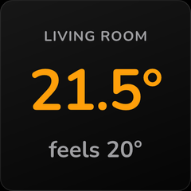 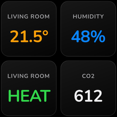 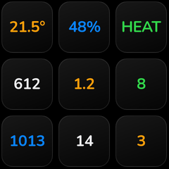

```html
<div class="cell">
  <div class="t-label hide-short">{{ name | upper }}</div>
  <div class="t-hero">{{ state }}&deg;</div>
  <div class="t-unit hide-small">feels 20&deg;</div>
</div>
```

These samples are generated by `scripts/generate_html_samples.py` (run via `scripts/update_samples.py`).

## Animated widgets (opt-in)

Turn on the device's **Animations** switch entity and any HTML widget with its **Animate** option enabled renders its CSS animations (`@keyframes`) to a looping animated GIF, which the display plays natively. Views without animated widgets keep the smaller, faster JPEG path, and static cells in an animated view are rendered once and shared across frames. The **Animation Loop** option sets the loop length (0.8–4s; the view uses the longest loop among its widgets, at 10fps up to 2s and 7fps beyond). Every example below loops in 2 seconds.

### What animates

- **Interpolates:** `transform` (`translate`, `rotate`, `scale`, with `transform-origin`), `opacity`, `color`, `background-color`, `box-shadow`, `background-position`, sizes and offsets (`width`, `left`, …), `border-radius`, `border-width`, `font-size` and `letter-spacing`.
- **Doesn't:** anything inside an `<svg>`. SMIL `<animate>`, CSS animations on SVG shapes and `stroke-dashoffset` all render static. Animate the HTML element wrapping the SVG instead (rotate it, move it, fade it); the [wind turbine](#wind-turbine) and the [thunderstorm](#thunderstorm)'s lightning work that way. `filter` isn't supported at all.
- **Staggering:** negative `animation-delay` starts an element partway through its cycle, so copies of one animation can run out of phase (rain, ripples, equalizer bars).

### Seamless loops

The GIF repeats the loop forever, so the last frame has to flow into the first:

- Make every duration equal to the loop, or divide it evenly (a 0.5s raindrop falls four times in a 2s loop).
- Prefer full turns (`rotate(0deg)` → `rotate(360deg)`) and ping-pong keyframes whose `0%` and `100%` are identical (`0%, 100% { … } 50% { … }`).
- Avoid sliding a gradient by a percentage `background-position`: it seams when it wraps. Cross-fade two layers with `opacity`, or move an element instead.

Animations are off by default: a GIF costs upload size and device decode time. The upload budget is 400KB; past it, the integration shows the first frame as a still image. The generator checks every example below against that budget.

### Radar sweep

A conic-gradient beam turns once per loop; each person at home is a blip whose ping is delayed to fire exactly as the beam passes it (`animation-delay` = the blip's angle as a share of the turn). Positions come from `rotate() translateY() rotate()`, so no trigonometry in Jinja.


```html


<style>
/* One full turn per 2 s loop: rotation is seamless. */
@keyframes sweep { from { transform: rotate(0deg); } to { transform: rotate(360deg); } }
@keyframes ping { 0% { transform: scale(0.6); opacity: 1; } 70%, 100% { transform: scale(2.6); opacity: 0; } }
.scope { position: absolute; top: 4px; left: 4px; right: 4px; bottom: 4px; border-radius: 50%;
         background: radial-gradient(circle, #06240f 0%, #031208 70%, #010603 100%);
         box-shadow: inset 0 0 0 2px #1d6b33, inset 0 0 40px rgba(48,209,88,0.25); }
.c { position: absolute; left: 50%; top: 50%; }
.ring { border-radius: 50%; border: 1px solid rgba(48,209,88,0.35); }
.axis { background: rgba(48,209,88,0.25); }
.beam { top: 0; left: 0; right: 0; bottom: 0; border-radius: 50%;
        background: conic-gradient(from 0deg, rgba(48,209,88,0) 0deg, rgba(48,209,88,0) 290deg,
                    rgba(48,209,88,0.55) 358deg, #b9ffcb 359deg, rgba(48,209,88,0) 360deg);
        animation: sweep 2s linear infinite; }
.blip { width: 12px; height: 12px; margin: -6px 0 0 -6px; border-radius: 50%; background: #6dff9a;
        box-shadow: 0 0 10px #30d158; }
.wave { width: 12px; height: 12px; margin: -6px 0 0 -6px; border-radius: 50%;
        border: 2px solid #6dff9a; animation: ping 2s ease-out infinite; }
.tag { width: 20px; margin: 4px 0 0 -10px; text-align: center; font-size: 10px; font-weight: 800; color: #6dff9a; }
.hud { width: 160px; margin-left: -80px; text-align: center; line-height: 1; }
.hud b { font-size: 34px; font-weight: 800; color: #eafff0; }
.hud span { display: block; font-size: 10px; font-weight: 800; letter-spacing: 0.2em; color: #30d158; margin-top: 3px; }
</style>
<div class="scope">
  
  <div class="c ring" style="width: {{ r * 2 }}px; height: {{ r * 2 }}px; margin: -{{ r }}px 0 0 -{{ r }}px"></div>
  
  <div class="c axis" style="width: 1px; height: 216px; margin: -108px 0 0 0"></div>
  <div class="c axis" style="width: 216px; height: 1px; margin: 0 0 0 -108px"></div>
  <div class="c beam" style="left: 0; top: 0"></div>
  
  {# Ping when the beam passes: delay = angle's share of the 2 s turn. #}
  <div class="c" style="transform: rotate({{ angle }}deg) translateY(-{{ dist }}px) rotate(-{{ angle }}deg)">
    <div class="c wave" style="animation-delay: -{{ 2 - angle / 180 }}s"></div>
    <div class="c blip"></div><div class="c tag">{{ tag }}</div>
  </div>
  
  <div class="c hud" style="top: 160px"><b>{{ home | length }}</b><span>AT HOME</span></div>
</div>
```

### Now playing

A record built from `repeating-radial-gradient` grooves spins only while `media_player.living_room` is playing; an equalizer of `scaleY` bars with staggered negative delays bounces beside the title.


```html

<style>
@keyframes spin { from { transform: rotate(0deg); } to { transform: rotate(360deg); } }
@keyframes eq { 0%, 100% { transform: scaleY(0.25); } 50% { transform: scaleY(1); } }
.deck { position: absolute; top: 0; left: 0; right: 0; bottom: 0;
        background: radial-gradient(circle at 30% 20%, #2a1b3d 0%, #0b0710 70%); }
.record { position: absolute; top: 14px; left: 14px; width: 150px; height: 150px; border-radius: 50%;
          background: repeating-radial-gradient(circle, #111 0px, #111 2px, #222 3px, #111 4px);
          box-shadow: 0 8px 24px rgba(0,0,0,0.8), 0 0 0 2px #2b2b2b;
          {{ 'animation: spin 2s linear infinite;' if playing }} }
.label { position: absolute; top: 47px; left: 47px; width: 56px; height: 56px; border-radius: 50%;
         background: conic-gradient(#ff375f 0deg 90deg, #ffd60a 90deg 180deg, #ff375f 180deg 270deg, #ffd60a 270deg 360deg);
         display: flex; align-items: center; justify-content: center; }
.label i { width: 8px; height: 8px; border-radius: 50%; background: #0b0710; }
.sheen { position: absolute; top: 14px; left: 14px; width: 150px; height: 150px; border-radius: 50%;
         background: conic-gradient(from 20deg, rgba(255,255,255,0) 0deg, rgba(255,255,255,0.10) 30deg,
                     rgba(255,255,255,0) 70deg, rgba(255,255,255,0) 200deg, rgba(255,255,255,0.08) 230deg,
                     rgba(255,255,255,0) 260deg); }
.arm { position: absolute; top: 18px; left: 192px; width: 6px; height: 112px; border-radius: 3px;
       background: linear-gradient(#e5e5ea, #8e8e93); transform-origin: 50% 0%; transform: rotate(28deg); }
.pivot { position: absolute; top: 10px; left: 183px; width: 24px; height: 24px; border-radius: 50%;
         background: radial-gradient(circle at 40% 35%, #f2f2f7, #636366); }
.meta { position: absolute; left: 16px; right: 16px; bottom: 14px; display: flex; align-items: flex-end;
        justify-content: space-between; }
.title { font-size: 18px; font-weight: 800; color: #fff; line-height: 1.1; white-space: nowrap; }
.artist { font-size: 13px; font-weight: 600; color: rgba(255,255,255,0.6); }
.bars { display: flex; align-items: flex-end; gap: 3px; height: 30px; }
.bars i { width: 5px; height: 30px; border-radius: 2px; background: linear-gradient(#ffd60a, #ff375f);
          transform-origin: 50% 100%; animation: eq 1s ease-in-out infinite; }
</style>
<div class="deck"></div>
<div class="record"><div class="label"><i></i></div></div>
<div class="sheen"></div>
<div class="pivot"></div><div class="arm"></div>
<div class="meta">
  <div>
    <div class="title">{{ state_attr('media_player.living_room', 'media_title') | truncate(16, true, '…', 0) }}</div>
    <div class="artist">{{ state_attr('media_player.living_room', 'media_artist') }}</div>
  </div>
  <div class="bars">
    <i style="animation-delay: {{ d }}s"></i>
  </div>
</div>
```

### Thunderstorm

Rain is 34 drops on staggered delays inside a tilted container, falling four times per loop. Two cloud banks sway in opposite directions, and a lightning bolt (SVG) flashes with the whole sky.


```html

<style>
/* Drops fall 300px in 0.5 s: four falls per 2 s loop, so the loop is seamless. */
@keyframes fall { from { transform: translateY(-60px); } to { transform: translateY(240px); } }
@keyframes drift { 0%, 100% { transform: translateX(-12px); } 50% { transform: translateX(12px); } }
@keyframes drift2 { 0%, 100% { transform: translateX(10px); } 50% { transform: translateX(-10px); } }
@keyframes flash { 0%, 62%, 70%, 76%, 100% { opacity: 0; } 64% { opacity: 0.6; } 73% { opacity: 0.45; } }
.sky { position: absolute; top: 0; left: 0; right: 0; bottom: 0;
       background: linear-gradient(180deg, #0f1522 0%, #1f2b3d 55%, #33475f 100%); }
.flash { position: absolute; top: 0; left: 0; right: 0; bottom: 0; background: #dbe6ff;
         animation: flash 2s linear infinite; }
.bolt { position: absolute; top: 74px; left: 132px; width: 54px; animation: flash 2s linear infinite; }
.rain { position: absolute; top: -20px; left: -30px; width: 300px; height: 280px; transform: rotate(12deg); }
.drop { position: absolute; top: 0; width: 3px; border-radius: 1px;
        background: linear-gradient(rgba(170,210,255,0), rgba(190,220,255,0.9));
        animation: fall 0.5s linear infinite; }
.cloud { position: absolute; }
.puff { position: absolute; border-radius: 50%; }
.read { position: absolute; left: 16px; bottom: 14px; color: #fff; line-height: 1; }
.read b { font-size: 64px; font-weight: 800; letter-spacing: -0.03em; }
.read span { display: block; font-size: 14px; font-weight: 700; opacity: 0.8; margin-top: 4px; }
</style>
<div class="sky"></div>
<div class="flash"></div>
<div class="rain">

  <div class="drop" style="left: {{ (i * 53) % 290 }}px; height: {{ 16 + (i % 4) * 6 }}px;
       animation-delay: -{{ (i * 0.137) % 0.5 }}s; opacity: {{ 0.35 + (i % 3) * 0.25 }}"></div>

</div>
<div class="cloud" style="top: 12px; left: 110px; width: 130px; height: 60px; animation: drift2 2s ease-in-out infinite">
  
  <div class="puff" style="left: {{ l }}px; top: {{ tp }}px; width: {{ w }}px; height: {{ w if w < 100 else 36 }}px;
       background: linear-gradient(#59677b, #3a4657)"></div>
  
</div>
<div class="cloud" style="top: 34px; left: 20px; width: 150px; height: 66px; animation: drift 2s ease-in-out infinite">
  
  <div class="puff" style="left: {{ l }}px; top: {{ tp }}px; width: {{ w }}px; height: {{ w if w < 100 else 40 }}px;
       background: linear-gradient(#aab6c6, #6b7a8f)"></div>
  
</div>
{# The bolt is plain SVG: it flashes because its wrapper's opacity animates. #}
<div class="bolt"><svg viewBox="0 0 40 80" style="width: 54px">
  <path d="M24 0 L6 44 L18 44 L10 80 L36 30 L22 30 L32 0 Z" fill="#fff6c2"/></svg></div>
<div class="read"><b>{{ t | round | int }}&deg;</b>
  <span>{{ name }} · Thunderstorm {{ state_attr('weather.london', 'precipitation_probability') }}%</span></div>
```

### Doorbell

Three ripples, a third of a loop apart, expand and fade from the button while the bell rocks on a `transform-origin` near its top. Both are switched off in Jinja when the doorbell is idle.


```html

<style>
@keyframes ripple { 0% { transform: scale(0.45); opacity: 0.9; } 100% { transform: scale(1.6); opacity: 0; } }
@keyframes ring { 0%, 50%, 100% { transform: rotate(0deg); } 10%, 30% { transform: rotate(-16deg); }
                  20%, 40% { transform: rotate(16deg); } }
.bg { position: absolute; top: 0; left: 0; right: 0; bottom: 0; background: #140b02; }
.c { position: absolute; left: 50%; top: 42%; }
.wave { width: 150px; height: 150px; margin: -75px 0 0 -75px; border-radius: 50%;
        border: 3px solid #ffb340; animation: ripple 2s ease-out infinite; }
.btn { width: 96px; height: 96px; margin: -48px 0 0 -48px; border-radius: 50%;
       background: radial-gradient(circle at 40% 30%, #ffd27a, #ff9f0a 60%, #c46a00 100%);
       box-shadow: 0 0 30px rgba(255,159,10,0.7), inset 0 -6px 12px rgba(0,0,0,0.3);
       display: flex; align-items: center; justify-content: center; }
.bell { font-size: 52px; color: #2a1600; transform-origin: 50% 10%; {{ 'animation: ring 1s ease-in-out infinite;' if ringing }} }
.txt { position: absolute; left: 0; right: 0; bottom: 18px; text-align: center; line-height: 1; }
.txt b { font-size: 22px; font-weight: 800; color: #fff; }
.txt span { display: block; font-size: 13px; font-weight: 700; color: #ffb340; margin-top: 5px; letter-spacing: 0.08em; }
</style>
<div class="bg"></div>

  <div class="c wave" style="animation-delay: {{ d }}s"></div>

<div class="c btn"><span class="icon bell">&#xF009A;</span></div>
<div class="txt"><b>{{ 'Someone at the door' if ringing else 'Front door' }}</b>
  <span>{{ name | upper }} · {{ now.strftime('%H:%M') }}</span></div>
```

### Washing machine

Laundry tumbles in a rotating drum behind a glass reflection, and bubbles rise on staggered delays. The progress bar and phase come from three sensors.


```html


<style>
@keyframes tumble { from { transform: rotate(0deg); } to { transform: rotate(360deg); } }
@keyframes rise { 0% { transform: translateY(0px) scale(0.6); opacity: 0; } 20% { opacity: 0.9; }
                  100% { transform: translateY(-70px) scale(1.1); opacity: 0; } }
.body { position: absolute; top: 0; left: 0; right: 0; bottom: 0;
        background: linear-gradient(180deg, #f2f2f7 0%, #d1d1d6 100%); }
.c { position: absolute; left: 50%; top: 104px; }
.rim { width: 164px; height: 164px; margin: -82px 0 0 -82px; border-radius: 50%;
       background: conic-gradient(#8e8e93, #f2f2f7, #8e8e93, #e5e5ea, #8e8e93);
       box-shadow: 0 6px 16px rgba(0,0,0,0.3); }
.glass { width: 140px; height: 140px; margin: -70px 0 0 -70px; border-radius: 50%; overflow: hidden;
         background: radial-gradient(circle at 50% 70%, #0a84ff 0%, #064a8f 55%, #02203f 100%);
         box-shadow: inset 0 8px 20px rgba(0,0,0,0.55); }
.drum { position: absolute; top: 0; left: 0; width: 140px; height: 140px; animation: tumble 2s linear infinite; }
.sock { position: absolute; border-radius: 40%; }
.bub { position: absolute; width: 10px; height: 10px; border-radius: 50%;
       border: 1.5px solid rgba(255,255,255,0.8); animation: rise 2s ease-in infinite; }
.shine { width: 140px; height: 140px; margin: -70px 0 0 -70px; border-radius: 50%;
         background: linear-gradient(135deg, rgba(255,255,255,0.35) 0%, rgba(255,255,255,0) 40%); }
.panel { position: absolute; top: 10px; left: 14px; right: 14px; display: flex; justify-content: space-between;
         align-items: center; font-size: 11px; font-weight: 800; letter-spacing: 0.14em; color: #3a3a3c; }
.led { color: #30d158; }
.foot { position: absolute; left: 16px; right: 16px; bottom: 12px; display: flex; align-items: center; gap: 10px; }
.foot b { font-size: 22px; font-weight: 800; color: #1c1c1e; white-space: nowrap; }
.track { flex: 1; height: 8px; border-radius: 4px; background: rgba(0,0,0,0.12); }
.fill { height: 8px; border-radius: 4px; background: #0a84ff; width: {{ pct }}%; }
</style>
<div class="body"></div>
<div class="panel"><span>{{ name | upper }}</span><span class="led">&#9679; {{ states('sensor.washer_phase') | upper }}</span></div>
<div class="c rim"></div>
<div class="c glass">
  <div class="drum">
    <div class="sock" style="left: 26px; top: 30px; width: 40px; height: 26px; background: #ff375f"></div>
    <div class="sock" style="left: 78px; top: 44px; width: 36px; height: 30px; background: #ffd60a"></div>
    <div class="sock" style="left: 40px; top: 84px; width: 46px; height: 24px; background: #30d158"></div>
    <div class="sock" style="left: 92px; top: 88px; width: 26px; height: 26px; background: #bf5af2"></div>
  </div>
  
  <div class="bub" style="left: {{ 22 + i * 18 }}px; top: 110px; animation-delay: -{{ (i * 0.7) % 2 }}s"></div>
  
</div>
<div class="c shine"></div>
<div class="foot"><b>{{ left }} min</b><div class="track"><div class="fill"></div></div></div>
```

### Wind turbine

The scenery and both rotors are SVG. Shapes inside an SVG can't animate, but the element wrapping one can, so each rotor is an SVG in a spinning `<div>`.


```html

<style>
/* SVG can't animate from inside, but the element wrapping it can:
   each rotor is an SVG in a div that spins around its centre. */
@keyframes spin { from { transform: rotate(0deg); } to { transform: rotate(360deg); } }
.sky { position: absolute; top: 0; left: 0; right: 0; bottom: 0;
       background: linear-gradient(180deg, #1e4f8f 0%, #5fa4d9 60%, #a9d4f2 100%); }
.rotor { position: absolute; animation: spin 2s linear infinite; }
.read { position: absolute; top: 14px; left: 16px; color: #fff; line-height: 1; }
.read b { font-size: 48px; font-weight: 800; letter-spacing: -0.03em; }
.read b small { font-size: 18px; opacity: 0.8; letter-spacing: 0; }
.read span { display: block; font-size: 11px; font-weight: 800; letter-spacing: 0.16em; opacity: 0.85; margin-top: 4px; }
</style>
<div class="sky"></div>
{# Far turbine, then hills, then the near turbine: plain SVG, no animation. #}
<svg style="position: absolute; top: 0; left: 0; width: 240px" viewBox="0 0 240 240">
  <path d="M58 120 L61 120 L63 196 L56 196 Z" fill="#dfe8f2"/>
  <path d="M0 190 C 60 160, 120 200, 240 170 L240 240 L0 240 Z" fill="#3f7d4a"/>
  <path d="M0 214 C 80 190, 160 230, 240 205 L240 240 L0 240 Z" fill="#2e6338"/>
  <path d="M160 108 L167 108 L171 226 L156 226 Z" fill="#f4f7fb"/>
</svg>
<div class="rotor" style="left: 30px; top: 92px; width: 58px; height: 58px">
  <svg viewBox="0 0 100 100" style="width: 58px">
    
    <path d="M50 50 C 46 30, 47 10, 50 2 C 53 10, 54 30, 50 50 Z" fill="#eef3f8" transform="rotate({{ a }} 50 50)"/>
    
    <circle cx="50" cy="50" r="5" fill="#c9d4df"/>
  </svg>
</div>
<div class="rotor" style="left: 105px; top: 50px; width: 116px; height: 116px; animation-delay: -0.4s">
  <svg viewBox="0 0 100 100" style="width: 116px">
    
    <path d="M50 50 C 45 30, 46 10, 50 1 C 54 10, 55 30, 50 50 Z" fill="#ffffff" transform="rotate({{ a }} 50 50)"/>
    
    <circle cx="50" cy="50" r="6" fill="#d6dee7"/>
  </svg>
</div>
<div class="read"><b>{{ kw }}<small> kW</small></b><span>{{ name | upper }}</span></div>
```

### Lava lamp

Three soft radial-gradient blobs wander on ping-pong paths and scale as they cross, behind a large reading.


```html
<style>
/* Soft radial blobs wander on ping-pong paths (0% = 100%), so the loop never jumps. */
@keyframes a { 0%, 100% { transform: translate(0px, 0px) scale(1); } 50% { transform: translate(60px, 40px) scale(1.25); } }
@keyframes b { 0%, 100% { transform: translate(0px, 0px) scale(1.2); } 50% { transform: translate(-70px, -30px) scale(0.9); } }
@keyframes c { 0%, 100% { transform: translate(0px, 0px); } 50% { transform: translate(30px, -60px); } }
.bg { position: absolute; top: 0; left: 0; right: 0; bottom: 0; background: #0b0420; }
.blob { position: absolute; border-radius: 50%; }
.read { position: absolute; top: 0; left: 0; right: 0; bottom: 0; display: flex; flex-direction: column;
        align-items: center; justify-content: center; color: #fff; line-height: 1; }
.read span { font-size: 14px; font-weight: 800; letter-spacing: 0.2em; opacity: 0.85; }
.read b { font-size: 88px; font-weight: 800; letter-spacing: -0.04em; margin: 6px 0; }
.read em { font-style: normal; font-size: 15px; font-weight: 700; opacity: 0.85; }
</style>
<div class="bg"></div>
<div class="blob" style="left: -40px; top: -30px; width: 200px; height: 200px; animation: a 2s ease-in-out infinite;
     background: radial-gradient(circle, rgba(255,55,95,0.9) 0%, rgba(255,55,95,0) 70%)"></div>
<div class="blob" style="left: 90px; top: 80px; width: 200px; height: 200px; animation: b 2s ease-in-out infinite;
     background: radial-gradient(circle, rgba(10,132,255,0.9) 0%, rgba(10,132,255,0) 70%)"></div>
<div class="blob" style="left: 20px; top: 110px; width: 160px; height: 160px; animation: c 2s ease-in-out infinite;
     background: radial-gradient(circle, rgba(191,90,242,0.85) 0%, rgba(191,90,242,0) 70%)"></div>
<div class="read"><span>{{ name | upper }}</span><b>{{ state }}&deg;</b><em>{{ states('sensor.living_humidity') }}% humidity</em></div>
```

## Limitations

No JavaScript, no network fetches (use `data:` URIs for images), no `background-clip: text`, no `text-shadow`, no `filter`, and nothing animates inside an `<svg>` (animate its wrapper). `text-overflow: ellipsis` clips without drawing the "…", so truncate long strings in the template (e.g. `{{ name | truncate(12, true, '…', 0) }}`).
