# Layouts

A view's layout splits the 240×240 screen into slots; each slot holds one widget. Pick it in the View Editor's **Layout** picker. Widgets adapt to the slot size they get (see every widget at every size in [Widgets](widgets.md)).

There are 19 layouts. The ID column is the value stored in the view config.

## Fullscreen & grids

  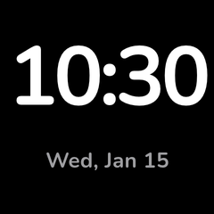
  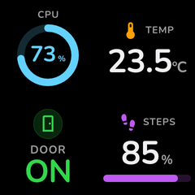
  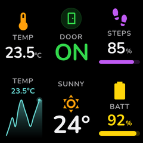
  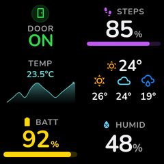
  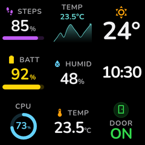

| Layout | ID | Slots | Description |
|--------|----|:-----:|-------------|
| Fullscreen | `fullscreen` | 1 | Single widget fills the entire display |
| Grid 2x2 | `grid_2x2` | 4 | 2×2 grid of equal widgets |
| Grid 2x3 | `grid_2x3` | 6 | 2 rows, 3 columns |
| Grid 3x2 | `grid_3x2` | 6 | 3 rows, 2 columns |
| Grid 3x3 | `grid_3x3` | 9 | 3×3 grid of equal widgets |

## Splits

  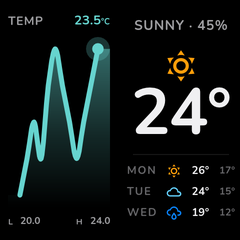
  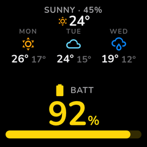
  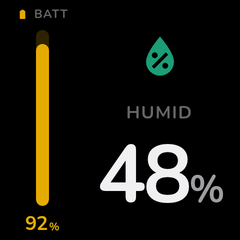
  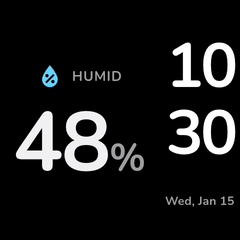

| Layout | ID | Slots | Description |
|--------|----|:-----:|-------------|
| Split horizontal | `split_horizontal` | 2 | Left/right, side by side |
| Split vertical | `split_vertical` | 2 | Top/bottom, stacked |
| Split 1:2 | `split_h_1_2` | 2 | Narrow left (1/3), wide right (2/3) |
| Split 2:1 | `split_h_2_1` | 2 | Wide left (2/3), narrow right (1/3) |

## Columns & rows

  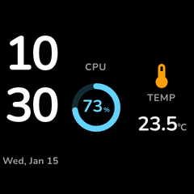
  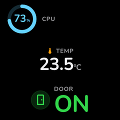

| Layout | ID | Slots | Description |
|--------|----|:-----:|-------------|
| Three columns | `three_column` | 3 | 3 vertical columns |
| Three rows | `three_row` | 3 | 3 horizontal rows |

## Hero

  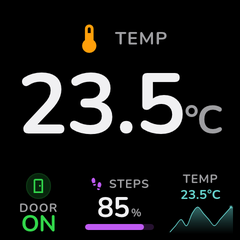
  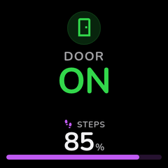
  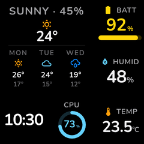
  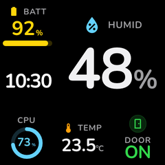
  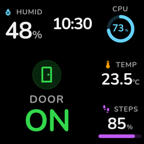
  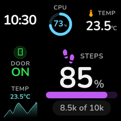

| Layout | ID | Slots | Description |
|--------|----|:-----:|-------------|
| Hero | `hero` | 4 | Large hero + 3 footer widgets |
| Hero simple | `hero_simple` | 2 | Large hero + 1 footer widget |
| Hero corner TL | `hero_corner_tl` | 6 | 2×2 hero top-left + 5 small widgets |
| Hero corner TR | `hero_corner_tr` | 6 | 2×2 hero top-right + 5 small widgets |
| Hero corner BL | `hero_corner_bl` | 6 | 2×2 hero bottom-left + 5 small widgets |
| Hero corner BR | `hero_corner_br` | 6 | 2×2 hero bottom-right + 5 small widgets |

## Sidebars

  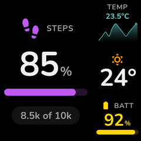
  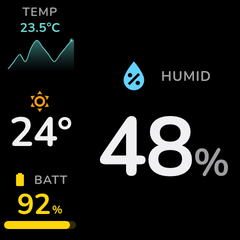

| Layout | ID | Slots | Description |
|--------|----|:-----:|-------------|
| Sidebar left | `sidebar_left` | 4 | Wide left panel + 3 rows on the right |
| Sidebar right | `sidebar_right` | 4 | 3 rows on the left + wide right panel |
