# Widgets

Every widget is configured in the GeekMagic panel (**View Editor → Widgets**): pick a type, an entity, and the options listed below. Each one adapts to the cell it lands in, so the same widget is shown here at every size, from fullscreen (`1x1`) to a 3×3 grid cell.

Sizes read *rows × columns*: `1x2` is two cells side by side, `2x1` two stacked, `2x3` two rows of three.

**Contents:** [Entity](#entity) · [Date / Time](#date--time) · [Gauge](#gauge) · [Progress](#progress) · [Multi Progress](#multi-progress) · [Clock](#clock) · [Weather](#weather) · [Status](#status) · [Status List](#status-list) · [Climate](#climate) · [Chart](#chart) · [Candlestick Chart](#candlestick-chart) · [Media Player](#media-player) · [Camera](#camera) · [Image](#image) · [Text](#text) · [Attribute List](#attribute-list) · [HTML](#html) · [Templates in labels](#templates-in-labels)

## Entity

`entity` — any Home Assistant entity's state, with its icon, name and unit. Use **Entity Attribute** to show an attribute instead of the state.

Options: Show Name / Unit / Icon, Icon Override, On Icon / Off Icon ([details](#different-icons-for-on-and-off)), Decimal Places, Entity Attribute.

With an **Icon Override**:

| 1x1 | 1x2 | 2x1 | 2x2 |
|:-:|:-:|:-:|:-:|
| 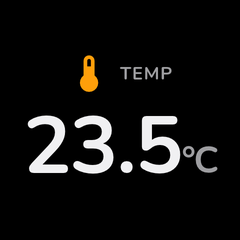 | 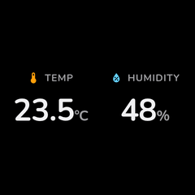 | 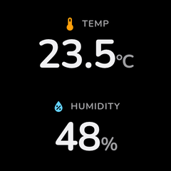 | 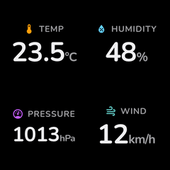 |
| **2x3** | **3x2** | **3x3** | |
|  | 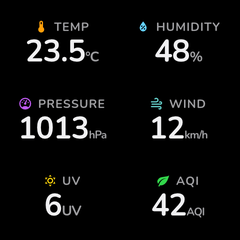 |  | |

With the entity's own icon (no override):

| 1x1 | 1x2 | 2x1 | 2x2 |
|:-:|:-:|:-:|:-:|
|  |  |  |  |
| **2x3** | **3x2** | **3x3** | |
| 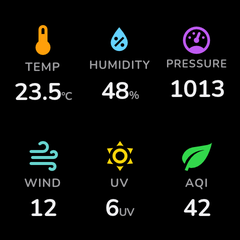 |  | 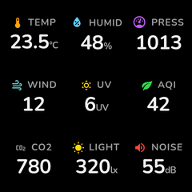 | |

### Binary sensor states and icons

Binary sensors show human-readable states and state-specific icons based on their `device_class`. Icons come from Home Assistant's own icon definitions.

<p align="center">
  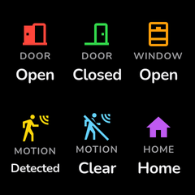
  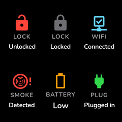
</p>

### Domain state icons

Lights, switches, fans and similar entities switch icons with their on/off state.

<p align="center">
  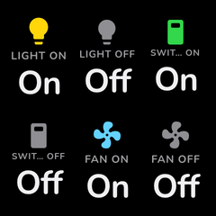
</p>

## Date / Time

`datetime` — a specialisation of Entity for sensors whose value is a timestamp (e.g. `2026-07-09T14:33:01+00:00`), which doesn't fit a 240×240 cell as a raw ISO string. Same icon/name/caption behaviour as Entity.

| 1x1 | 1x2 | 2x1 | 2x2 |
|:-:|:-:|:-:|:-:|
| 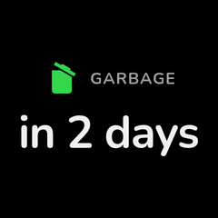 | 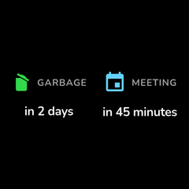 | 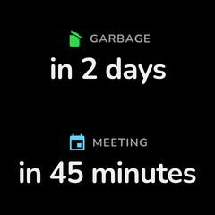 | 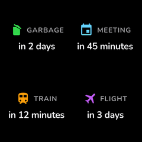 |
| **2x3** | **3x2** | **3x3** | |
| 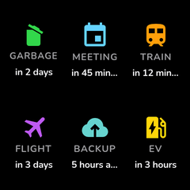 | 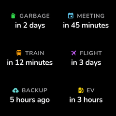 | 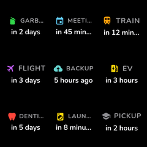 | |

The **Format** option (`timestamp_format`) reformats any value that parses as an ISO-8601 timestamp:

| Value | Renders as | Example |
|-------|------------|---------|
| `relative` | Relative to now (default) | `in 1 hour`, `2 hours ago`, `now` |
| `time` | Local time | `14:33` |
| `date` | Local date | `Jul 09` |
| `datetime` | Local date + time | `Jul 09 14:33` |
| `custom` | Your `strftime` pattern | see below |
| `default` | Unchanged (raw value) | `2026-07-09T14:33:01+00:00` |

For `custom`, set **Custom Format** (`timestamp_custom_format`) to any [`strftime`](https://docs.python.org/3/library/datetime.html#strftime-and-strptime-format-codes) pattern such as `%H:%M` (default) or `%a %H:%M`. Aware timestamps are converted to Home Assistant's local timezone (or the widget's **Timezone**) before formatting; non-timestamp values pass through unchanged, and relative values refresh on the display's update interval. Works with **Entity Attribute** too, so a sensor's timestamp attribute can be formatted the same way.

## Gauge

`gauge` — a numeric value against a min/max range, in three styles. Value and fill share the gauge's tint, like Apple's Activity rings.

Options: Style (`bar` / `ring` / `arc`), Bar Orientation, Minimum, Maximum, Unit Override, Decimal Places, Show Name / Value / Unit, Icon, Entity Attribute, Color Thresholds.

Bar:

| 1x1 | 1x2 | 2x1 | 2x2 |
|:-:|:-:|:-:|:-:|
| 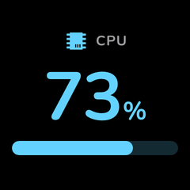 | 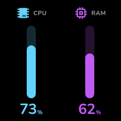 | 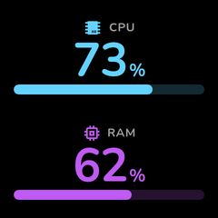 | 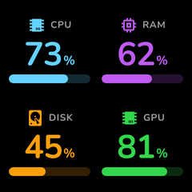 |
| **2x3** | **3x2** | **3x3** | |
| 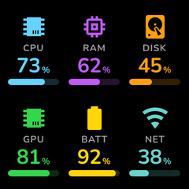 | 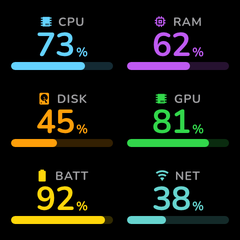 | 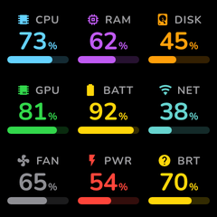 | |

Ring:

| 1x1 | 1x2 | 2x1 | 2x2 |
|:-:|:-:|:-:|:-:|
| 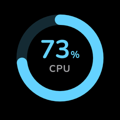 | 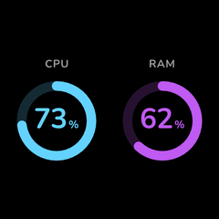 | 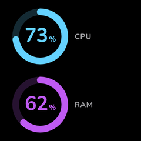 | 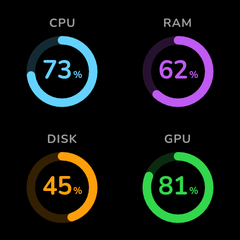 |
| **2x3** | **3x2** | **3x3** | |
| 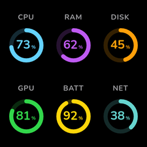 | 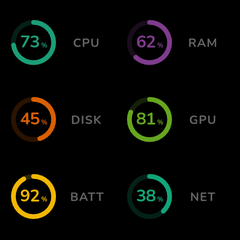 | 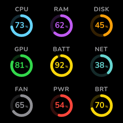 | |

Arc:

| 1x1 | 1x2 | 2x1 | 2x2 |
|:-:|:-:|:-:|:-:|
| 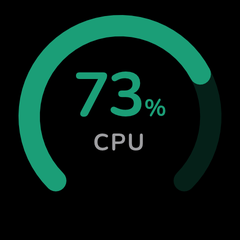 | 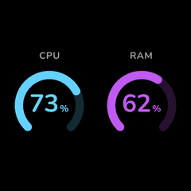 | 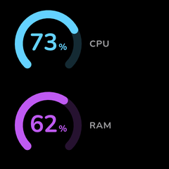 | 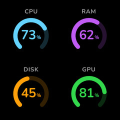 |
| **2x3** | **3x2** | **3x3** | |
| 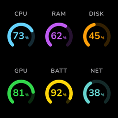 | 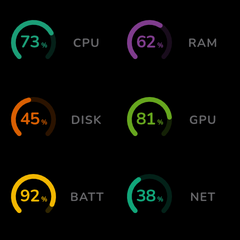 | 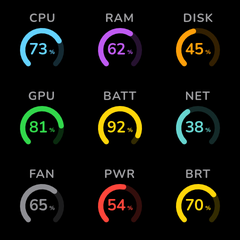 | |

## Progress

`progress` — progress toward a goal (steps, calories, water…).

Options: Target Value, Unit, Show Name, Show Target, Icon, Bar Height.

| 1x1 | 1x2 | 2x1 | 2x2 |
|:-:|:-:|:-:|:-:|
| 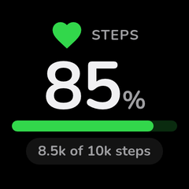 | 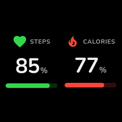 | 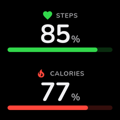 | 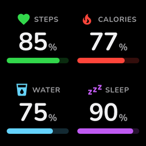 |
| **2x3** | **3x2** | **3x3** | |
| 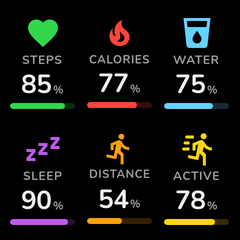 | 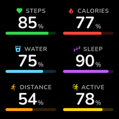 | 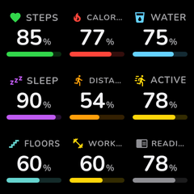 | |

## Multi Progress

`multi_progress` — several goals stacked in one cell, each with its own entity, label, target, colour and icon.

Options: Title, Progress Items.

| 1x1 | 1x2 | 2x1 | 2x2 |
|:-:|:-:|:-:|:-:|
| 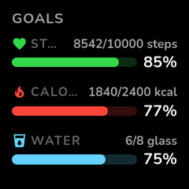 | 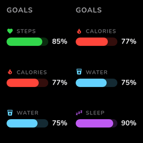 | 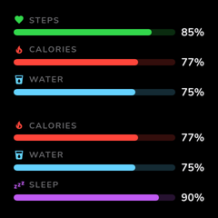 | 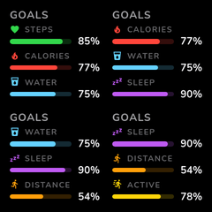 |
| **2x3** | **3x2** | **3x3** | |
| 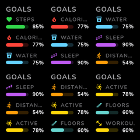 |  |  | |

## Clock

`clock` — the current time, optionally with the date and seconds, in any timezone.

Options: Show Date, Show Seconds, Time Format (`24h` / `12h`), Timezone.

| 1x1 | 1x2 | 2x1 | 2x2 |
|:-:|:-:|:-:|:-:|
|  |  |  |  |
| **2x3** | **3x2** | **3x3** | |
|  |  |  | |

## Weather

`weather` — current conditions from a `weather.*` entity with an optional daily forecast.

Options: Show Forecast, Forecast Days, Forecast Starts Tomorrow, Show Humidity, Show High/Low.

| 1x1 | 1x2 | 2x1 | 2x2 |
|:-:|:-:|:-:|:-:|
|  |  |  |  |
| **2x3** | **3x2** | **3x3** | |
|  |  |  | |

## Status

`status` — an on/off indicator for a binary sensor, switch, light or any entity with an on/off state. The icon's tint carries the state.

Options: On Text, Off Text, On Color, Off Color, Icon, On Icon / Off Icon, Show Status Text, Show Name.

| 1x1 | 1x2 | 2x1 | 2x2 |
|:-:|:-:|:-:|:-:|
|  |  |  |  |
| **2x3** | **3x2** | **3x3** | |
|  |  |  | |

### Showing a centered icon

To get a single, centered icon with no ON/OFF text, use the Status widget and turn its text off:

1. Pick a **Status** widget and choose the entity (for example a `binary_sensor`).
2. Optionally set **Icon** (for example `mdi:email`); otherwise the entity's own icon is used.
3. Turn **Show Status Text** off. The icon becomes the centerpiece of the cell and its tint shows the state (green when on, grey when off by default).
4. Turn **Show Name** off as well if you don't want the small name caption above the icon.

In option terms, that is `show_status_text: false` and `show_name: false`.

### Different icons for on and off

The **Status** and **Entity** widgets can swap the glyph with the state, e.g. `mdi:lightbulb` when a light is on and `mdi:lightbulb-off` when it is off. Set **On Icon** (`on_icon`) and/or **Off Icon** (`off_icon`) in the widget options.

The icon shown is picked in this order:

1. The icon for the current state (`on_icon` or `off_icon`), when set.
2. The generic **Icon** / **Icon Override** (`icon`), when set.
3. The icon Home Assistant uses for the entity (device-class and state aware).

What counts as on and off follows what each widget already shows:

| Widget | On | Off |
|--------|----|-----|
| `status` | The same states that show the **On Text** (`on`, `open`, `home`, `locked`, `unlocked`, `up`, `true`, `1`) | Everything else, including `unavailable`/`unknown` (the widget already shows **Off Text** for those) |
| `entity` | Any other live state (`on`, `playing`, `heat`, a number, …) | The states that grey the icon: `off`, `closed`, `away`, `not_home`, `idle`, `standby`, `paused`, `false`, `0` |

On the `entity` widget, `unavailable`/`unknown` are neither on nor off and keep the generic icon. Leaving both options empty keeps the default behaviour.

## Status List

`status_list` — several on/off entities as a titled list: icon, name and a state pill per row.

Options: Title, Status Entities, On Color, Off Color.

| 1x1 | 1x2 | 2x1 | 2x2 |
|:-:|:-:|:-:|:-:|
|  |  |  |  |
| **2x3** | **3x2** | **3x3** | |
|  |  |  | |

## Climate

`climate` — a thermostat or HVAC entity: current temperature, with target, humidity and HVAC mode as chips.

Options: Show Name, Show Target Temp, Show Humidity, Show HVAC Mode.

| 1x1 | 1x2 | 2x1 | 2x2 |
|:-:|:-:|:-:|:-:|
|  |  |  |  |
| **2x3** | **3x2** | **3x3** | |
|  |  |  | |

## Chart

`chart` — a sparkline of an entity's history over a chosen period.

Options: Period (5 min to 24 hours), Y-Axis Min/Max, Show Name, Show Current Value, Show Min/Max Range, Fill Area, Value Gradient.

| 1x1 | 1x2 | 2x1 | 2x2 |
|:-:|:-:|:-:|:-:|
|  |  |  |  |
| **2x3** | **3x2** | **3x3** | |
|  |  |  | |

Binary sensors chart as a stepped on/off trace:

| 1x1 | 1x2 | 2x1 | 2x2 |
|:-:|:-:|:-:|:-:|
|  |  |  |  |
| **2x3** | **3x2** | **3x3** | |
|  |  |  | |

## Candlestick Chart

`candlestick` — OHLC (open/high/low/close) candles built from any numeric entity's history, e.g. a price sensor.

Options: Candle Interval (`1 hour` / `4 hours` / `1 day`), Number of Candles, Show Name, Show Current Value.

| 1x1 | 1x2 | 2x1 | 2x2 |
|:-:|:-:|:-:|:-:|
|  |  |  |  |
| **2x3** | **3x2** | **3x3** | |
|  |  |  | |

<p align="center">
  
</p>

## Media Player

`media` — now playing from a `media_player.*` entity, with album art, artist and progress.

Options: Show Album Art, Show Title on Art, Show Artist, Show Album, Show Progress.

| 1x1 | 1x2 | 2x1 | 2x2 |
|:-:|:-:|:-:|:-:|
|  |  |  |  |
| **2x3** | **3x2** | **3x3** | |
|  |  |  | |

### Album art and art only

When the player provides a cover, the widget shows it full-bleed with the track details over its bottom edge. The options choose what goes on top of it:

- **Show Album Art** (`show_album_art`, on by default): turn it off to always use the text card, even when a cover is available. The cover is then not downloaded at all.
- **Show Title on Art** (`show_title`, on by default): the track title over the cover. It only applies over art: without a cover the title is what the card is about, so it always shows.
- **Show Artist** (`show_artist`), **Show Album** (`show_album`) and **Show Progress** (`show_progress`, the bar and the elapsed / total time) apply both over the cover and on the text card. Over the cover the album only appears in cells at least 130px on both sides.

Turn off the title, artist, album and progress to show only the cover, with no shading or text on it. A track without a cover still falls back to the text card, so the cell always says what is playing.

| Default | Art only | Art off | Progress only |
|:-:|:-:|:-:|:-:|
|  |  |  |  |

## Camera

`camera` — a camera snapshot, or the picture of an `image` entity (such as Frigate's latest detection, `image.front_camera_person`).

A `camera.*` snapshot is taken again on every refresh of the display. An `image.*` entity is read when it publishes a new picture (its state, `image_last_updated`, changes) and at least every 5 minutes otherwise, so a rarely changing picture isn't re-read and re-decoded every 10 seconds. If reading it fails, the last picture stays on screen and the read is retried a minute later, or as soon as the entity publishes a new picture. Pressing the device's **Refresh Display** button reads it again immediately. Pictures larger than 10 MB or 25 megapixels are refused, like the [Image](#image) widget's.

Options: Fit Mode (`cover` fills the cell, `contain` letterboxes), Show Label.

| 1x1 | 1x2 | 2x1 | 2x2 |
|:-:|:-:|:-:|:-:|
|  |  |  |  |
| **2x3** | **3x2** | **3x3** | |
|  |  |  | |

## Image

`image` — a picture that isn't a Home Assistant entity: a logo, a weather-radar PNG, an alarm icon. (For an `image.*` entity, use the [Camera](#camera) widget.) Set **Image URL or Path** (`source`) to one of:

| Source | Example |
|--------|---------|
| HTTP(S) URL | `https://example.com/radar.png` |
| File in `<config>/www/` | `/local/logo.png` or `www/logo.png` |
| Other allowed folder | `/media/pictures/cat.jpg` |

Local files must be inside a folder Home Assistant allows external access to: `<config>/www/`, your media folders, or anything you list under [`allowlist_external_dirs`](https://www.home-assistant.io/integrations/homeassistant/#allowlist_external_dirs). Other paths (including `..` segments and symlinks that point elsewhere) are refused, so the widget can't read `secrets.yaml`.

Options: Image URL or Path, Fit Mode, Reload Every, Show Label.

| 1x1 | 1x2 | 2x1 | 2x2 |
|:-:|:-:|:-:|:-:|
|  |  |  |  |
| **2x3** | **3x2** | **3x3** | |
|  |  |  | |

The picture is downloaded once and reused until **Reload Every** (`refresh`, default 1 hour) has passed; a failed reload keeps the last picture and retries a minute later. Pressing the device's **Refresh Display** button reloads it immediately. **Fit Mode** is `contain` (whole picture, letterboxed; the default), `cover` (fill and crop) or `stretch`. PNG/GIF transparency shows the theme background. Animated GIFs show their first frame: the device's animated path renders the whole screen from a CSS clock and can't step through a GIF's own frames.

The same sources work for the notify action's `image_url` ([details](automation.md#geekmagicnotify)).

## Text

`text` — static text, or an entity's state as text. Line breaks are kept.

Options: Text Content (accepts [templates](#templates-in-labels)), Entity.

| 1x1 | 1x2 | 2x1 | 2x2 |
|:-:|:-:|:-:|:-:|
|  |  |  |  |
| **2x3** | **3x2** | **3x3** | |
|  |  |  | |

Multi-line:

| 1x1 | 1x2 | 2x1 | 2x2 |
|:-:|:-:|:-:|:-:|
|  |  |  |  |
| **2x3** | **3x2** | **3x3** | |
|  |  |  | |

## Attribute List

`attribute_list` — several attributes of one entity as label/value rows (e.g. a bus arrival sensor's route, destination and ETA).

> **Note:** the panel's widget picker doesn't offer Attribute List yet (it has no editor schema), so it can't be added from the View Editor today.

| 1x1 | 1x2 | 2x1 | 2x2 |
|:-:|:-:|:-:|:-:|
|  |  |  |  |
| **2x3** | **3x2** | **3x3** | |
|  |  |  | |

## HTML

`html` — design your own cell with HTML/CSS and Jinja templates, optionally animated. See **[HTML widget](html-widget.md)**.

## Templates in labels

Every widget's **Label** field (and the Text widget's content) accepts a Home Assistant template, so any widget can carry a live caption without a separate Text widget:

```
Widget Type: Camera
Entity: camera.birdnet_vogelbild
Label: {{ states('sensor.birdnet_go_last_detection') }}
```

These are regular Home Assistant templates (`states()`, `state_attr()`, `is_state()`, `now()`, filters like `| float | round(1)`), evaluated on every refresh. The widget's own entity is also available as `entity_id`, `state`, `name`, `unit` and `attributes`. A label whose template evaluates to nothing is hidden; one with an error is shown as its raw text (and logged), so the mistake stays visible.
